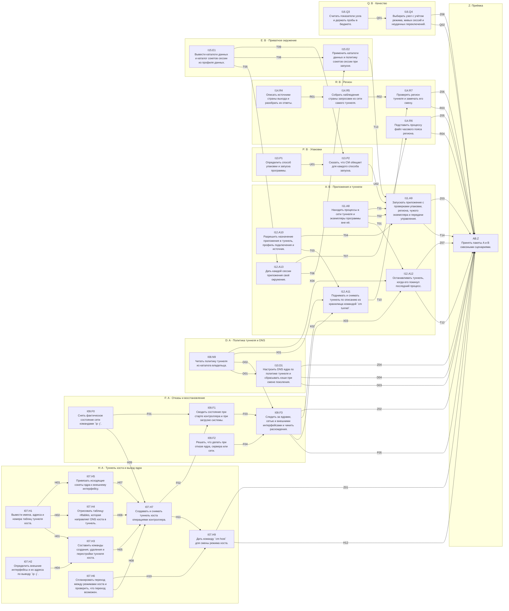

# Пакеты A и B: туннель хоста, отказы, DNS, приложения, упаковки, регион, приватное окружение, качество — DAG

Дата: 2026-10-10. Источник: [tools/ab_dag.py](tools/ab_dag.py) (правится только он). Основания: [ADR-HOST-FLOW.md](ADR-HOST-FLOW.md), [ADR-DNS.md](ADR-DNS.md), [ADR-XRAY-DATAPATH.md](ADR-XRAY-DATAPATH.md), [ADR-PACKET-FLOW.md](ADR-PACKET-FLOW.md), [ADR-CONTROLLER.md](ADR-CONTROLLER.md), [QUESTIONS.md](QUESTIONS.md).

Схема:
- **направление** — группа вершин одной темы;
- **вершина** — одна задача (одно предложение);
- **ребро** u → v — контракт: что u гарантирует v, как это проверить и с какими значениями.

Роли:
- **роль 1** (Grok 4.7) пишет код всех вершин за один проход — [GROK-AB-CODE.md](GROK-AB-CODE.md);
- **роль 2** (Composer 2.5) пишет тесты и проверки по рёбрам следующей итерацией — [TESTS-AB.md](TESTS-AB.md).

Пакет A — этапы 4–5 общего плана (I07, I08, I09, I10), пакет B — этапы 6–7 (I11–I16). Они в одном графе: пакет B опирается на политику туннеля и сторож пакета A.
Данные — `tools/ab_net.py` и `tools/ab_apps.py`; этот документ — их объединение.

**Проект проверен лабораториями координатора** (2026-10-10, пространства имён, сеть хоста не менялась):
- путь данных хоста и выход ядра — `tools/host_flow_lab.sh`, результаты в [ADR-HOST-FLOW](ADR-HOST-FLOW.md);
- DNS туннеля — `tools/dns_probe_lab.sh`, результаты в [ADR-DNS](ADR-DNS.md);
- входящий TUN Xray — `tools/xray_tun_lab.sh`, результаты в [ADR-XRAY-DATAPATH](ADR-XRAY-DATAPATH.md).

Что из них следует для кода:
- ядро привязывает исходящие сокеты к внешнему интерфейсу (`auto-detect-interface: true`); меток сокетов нет;
- приёмник блокировки хоста — интерфейс `dummy`: `blackhole` в этой таблице ломает туннели приложений;
- правило `from <адрес внешнего интерфейса>` обязательно: без него строгий `rp_filter` отбрасывает ответы ядрам;
- DNS хоста на сервер локальной сети перенаправляется таблицей `ip cm_host`;
- `fake-ip` скрывает `NXDOMAIN` и записи HTTPS: по умолчанию `redir-host`;
- Xray не открывает заранее созданный TUN без привилегий: туннели приложений — только mihomo.

**Что в пакет не вошло и почему:**
- замена нынешнего VPN хоста новым путём: `cm host` работает рядом, а не вместо; при работающем VPN хоста `host_apply` отвечает `conflict`. Переключение продукта — после проверки на установленной системе;
- хосты с systemd-resolved: `host_apply` в режиме туннеля отвечает `unsupported`, пока перенаправление DNS для него не проверено;
- Xray как ядро туннеля приложения (`I05.T02.b`, `I05.T05.a`, `I10.T02.b`): нужен отдельный путь данных;
- IPv6 через туннель: политика `pass` отвечает `unsupported`;
- Flatpak и Snap: `unsupported_not_verified` до проверки на настоящих приложениях (`I13.T05.a`); AppImage — с ограничением, без проверки на настоящем образе;
- каталог устройств и отпечаток браузера (`I15-R.T04–T05`, `I15.T01.a`): решения Q26/Q27 за пользователем;
- проверка приватного окружения на настоящих приложениях и сохранность аккаунта (`I15.T05.a`);
- пилот качества на настоящих узлах (`I16.T03.a`): числа бюджета и порогов — исходные;
- запись сессий и результатов проверок в хранилище, интерфейс (`I17`);
- исключения Q09, cgroup на сессию, сон и пробуждение;
- проверки на установке (`X`), приёмка (`I18`).

## Направления

| | Направление | Цель | Вершины |
|---|---|---|---|
| H | A · Туннель хоста и выход ядра | CM сам ставит маршруты и фильтр туннеля хоста; ядро любого туннеля выходит наружу мимо него, без привилегий. | I07.H1, I07.H2, I07.H3, I07.H4, I07.H5, I07.H6, I07.H7, I07.H9 |
| F | A · Отказы и восстановление | После сбоя ядра, контроллера или перезагрузки состояние сходится само, а трафик не идёт напрямую. | I09.F0, I09.F1, I09.F2, I09.F3 |
| D | A · Политика туннеля и DNS | Политика туннеля читается из каталога владельца; DNS — резолвер ядра этого туннеля. | I08.N9, I10.D1 |
| A | B · Приложения и туннели | Туннель поднимается по описанию из хранилища; запуск замечает чужой экземпляр и передачу управления; у каждой сессии своё окружение. | I11.A8, I12.A10, I12.A13, I12.A11, I12.A12, I11.A9 |
| P | B · Упаковки | Для каждого способа запуска известно, какой процесс выходит в сеть, и что CM о нём может обещать. | I13.P1, I13.P2 |
| R | B · Регион | Страна выхода измеряется через сам туннель; часовой пояс применяется к процессу, хост не меняется. | I14.R6, I14.R4, I14.R5, I14.R7 |
| E | B · Приватное окружение | Каталоги данных и сокеты сессии отделяются по профилю данных. | I15.E1, I15.E2 |
| Q | B · Качество | Пробы укладываются в бюджет; узел не меняется под живыми сессиями. | I16.Q3, I16.Q4 |
| Z | Приёмка | Сквозные сценарии на стенде: хост и приложения одновременно, матрица отказов, ноль прямых пакетов. | AB.Z |

## Граф

Стрелка — ребро с контрактом, подпись — id ребра.

## Вершины

| Вершина | Задача | Размер | Уровень | Зависит от | Файлы |
|---|---|---|---|---|---|
| `I07.H1` | Вывести имена, адреса и номера таблиц туннеля хоста. | S | L1 | — | `src/net/host_plan.rs`, `src/net/mod.rs` |
| `I07.H2` | Определить внешние интерфейсы и их адреса по выводу `ip -j`. | S | L1 | — | `src/net/uplink.rs`, `src/net/mod.rs` |
| `I07.H3` | Составить команды создания, удаления и перестройки туннеля хоста. | M | L1 | I07.H1, I07.H2 | `src/net/host_commands.rs`, `src/net/mod.rs` |
| `I07.H4` | Отрисовать таблицу nftables, которая направляет DNS хоста в туннель. | S | L1 | I07.H1 | `src/net/host_firewall.rs`, `src/net/mod.rs` |
| `I07.H5` | Привязать исходящие сокеты ядра к внешнему интерфейсу. | S | L2 | I07.H1 | `src/core/mihomo/config.rs` |
| `I07.H6` | Спланировать переход между режимами хоста и проверить, что переход возможен. | S | L1 | — | `src/net/host.rs`, `src/net/mod.rs` |
| `I09.F0` | Снять фактическое состояние сети командами `ip -j`. | M | L2 | — | `src/net/query.rs`, `src/net/mod.rs`, `src/controller/net_ops.rs`, `src/controller/server.rs` |
| `I07.H7` | Создавать и снимать туннель хоста операциями контроллера. | L | L2 | I07.H3, I07.H4, I07.H5, I07.H6, I09.F0 | `src/controller/host_ops.rs`, `src/controller/protocol.rs`, `src/controller/actions.rs`, `src/controller/dispatch.rs`, `src/controller/core_ops.rs`, `src/controller/mod.rs`, `src/main.rs` |
| `I07.H9` | Дать команду `cm host` для смены режима хоста. | M | L2 | I07.H6, I07.H7 | `src/net/cli.rs`, `src/net/mod.rs`, `src/main.rs`, `src/i18n_table.rs` |
| `I08.N9` | Читать политику туннеля из каталога владельца. | S | L1 | — | `src/net/policy.rs`, `src/net/mod.rs`, `src/controller/owner.rs`, `src/controller/net_ops.rs` |
| `I10.D1` | Настроить DNS ядра по политике туннеля и сбрасывать кэши при смене поколения. | M | L2 | I08.N9 | `src/net/dns.rs`, `src/core/mihomo/config.rs`, `src/core/mihomo/lifecycle.rs`, `src/core/adapter.rs`, `src/controller/core_ops.rs` |
| `I09.F1` | Сводить состояние при старте контроллера и при загрузке системы. | L | L2 | I09.F0, I07.H7 | `src/controller/boot.rs`, `src/controller/server.rs`, `src/controller/mod.rs`, `src/main.rs` |
| `I09.F2` | Решать, что делать при отказе ядра, сервера или сети. | M | L1 | — | `src/net/failure.rs`, `src/net/mod.rs` |
| `I09.F3` | Следить за ядрами, сетью и внешними интерфейсами и чинить расхождения. | L | L2 | I09.F1, I09.F2, I08.N9 | `src/controller/watch.rs`, `src/controller/server.rs`, `src/controller/core_ops.rs`, `src/controller/protocol.rs`, `src/controller/dispatch.rs`, `src/controller/mod.rs` |
| `I11.A8` | Находить процессы в сети туннеля и экземпляры программы вне её. | M | L1 | — | `src/app/instance.rs`, `src/app/mod.rs`, `src/controller/protocol.rs`, `src/controller/app_ops.rs`, `src/controller/dispatch.rs` |
| `I12.A10` | Разрешить назначение приложения в туннель, профиль подключения и источник. | M | L1 | — | `src/app/assign.rs`, `src/app/mod.rs` |
| `I15.E1` | Вывести каталоги данных и каталог сокетов сессии из профиля данных. | S | L1 | — | `src/env/private.rs`, `src/env/mod.rs` |
| `I12.A13` | Дать каждой сессии приложения своё окружение. | M | L2 | I15.E1 | `src/app/env.rs`, `src/app/mod.rs`, `src/controller/protocol.rs`, `src/controller/codec.rs`, `src/controller/app_ops.rs` |
| `I15.E2` | Применить каталоги данных и политику сокетов сессии при запуске. | M | L2 | I15.E1, I12.A13 | `src/controller/app_ops.rs` |
| `I14.R6` | Подставить процессу файл часового пояса региона. | M | L2 | I12.A13 | `src/controller/drop.rs`, `src/controller/app_ops.rs` |
| `I12.A11` | Поднимать и снимать туннель по описанию из хранилища командой `cm tunnel`. | L | L2 | I12.A10, I08.N9, I09.F3 | `src/app/tunnel.rs`, `src/app/mod.rs`, `src/core/mihomo/config.rs`, `src/controller/client.rs`, `src/main.rs`, `src/i18n_table.rs` |
| `I12.A12` | Останавливать туннель, когда его покинул последний процесс. | M | L2 | I11.A8, I09.F3, I08.N9 | `src/controller/watch.rs`, `src/controller/app_ops.rs` |
| `I13.P1` | Определить способ упаковки и запуска программы. | S | L1 | — | `src/app/packaging/mod.rs`, `src/app/packaging/detect.rs`, `src/app/mod.rs` |
| `I13.P2` | Сказать, что CM обещает для каждого способа запуска. | S | L1 | I13.P1, I15.E1 | `src/app/packaging/policy.rs`, `src/app/packaging/mod.rs` |
| `I11.A9` | Запускать приложение с проверками упаковки, региона, чужого экземпляра и передачи управления. | L | L2 | I11.A8, I13.P2, I15.E2, I12.A10 | `src/app/cli.rs`, `src/i18n_table.rs` |
| `I14.R4` | Описать источники страны выхода и разобрать их ответы. | S | L1 | — | `src/env/sources.rs`, `src/env/mod.rs` |
| `I14.R5` | Собрать наблюдения страны запросами из сети самого туннеля. | M | L2 | I14.R4 | `src/env/collect.rs`, `src/env/mod.rs`, `src/main.rs` |
| `I14.R7` | Проверять регион туннеля и замечать его смену. | M | L2 | I14.R5, I12.A11 | `src/app/tunnel.rs`, `src/i18n_table.rs` |
| `I16.Q3` | Считать показатели узла и держать пробы в бюджете. | M | L1 | — | `src/quality/metrics.rs`, `src/quality/mod.rs` |
| `I16.Q4` | Выбирать узел с учётом режима, живых сессий и неудачных переключений. | M | L1 | I16.Q3 | `src/quality/select.rs`, `src/quality/mod.rs` |
| `AB.Z` | Принять пакеты A и B сквозными сценариями. | L | L2 | I07.H9, I09.F3, I10.D1, I12.A12, I11.A9, I14.R6, I14.R7, I16.Q4 | `docs/design/cm-network-manager/ab-evidence/<дата>/summary.json` |

## Рёбра: контракт, проверка, значения

### H01 · I07.H1 → I07.H3 (L1)

- **Контракт:** Номера и имена туннеля хоста постоянны и не пересекаются с туннелями приложений.
- **Как проверить:** `tests/audit_ab_host.rs`.
- **Значения:**
  - host_net(1000): tun "cmtunh", tun_addr "198.18.64.1/30", dns_addr "198.18.64.2", sink "cmsink", table 90, sink_table 91, rule_uplink 1900, rule_uplink_addr 1950, rule_main 1990, rule_tun 2000, rule_sink 2001, mtu 1400, owner_uid 1000
  - для всех i в 0..64: tunnel_net(i).table != 90 и != 91; rule_priority < 1900; tun_addr != "198.18.64.1/30"
  - tunnel_net(64, 0) == Err(BadIndex)
  - BOOTSTRAP_DNS == ["1.1.1.1", "8.8.8.8"]; те же два адреса стоят в `default-nameserver` результата attach_tun

### H02 · I07.H1 → I07.H4 (L2)

- **Контракт:** Таблица DNS хоста отрисована дословно и заменяется одной командой.
- **Как проверить:** `tests/audit_ab_host.rs`; загрузка — `nft -c -f -` в `unshare -rn`.
- **Значения:**
  - render_host_table(&host_net(0)) совпадает с текстом из вершины I07.H4 побайтно
  - host_firewall_commands(Some): одна команда Nft, args ["-f", "-"], stdin начинается с "table ip cm_host\ndelete table ip cm_host\n"
  - host_firewall_commands(None): stdin ровно "table ip cm_host\ndelete table ip cm_host\n"
  - `nft -c -f -` принимает оба текста (код 0)

### H03 · I07.H1 → I07.H5 (L1)

- **Контракт:** Ядро хоста получает TUN хоста тем же путём, что ядро приложения.
- **Как проверить:** `tests/audit_ab_host.rs`.
- **Значения:**
  - host_net(1000).as_tunnel(): index 64, tun "cmtunh", tun_addr "198.18.64.1/30", dns_addr "198.18.64.2", mtu 1400, owner_uid 1000, netns "", veth_host ""
  - attach_tun({"mode":"direct"}, &as_tunnel): tun.device "cmtunh", tun.inet4-address ["198.18.64.1/30"], tun.auto-route false
  - attach_tun для любого туннеля: tun.auto-detect-interface == true

### H04 · I07.H2 → I07.H3 (L1)

- **Контракт:** Внешние интерфейсы определяются по маршрутам по умолчанию, свои интерфейсы CM в них не попадают.
- **Как проверить:** `tests/audit_ab_host.rs`, фикстуры `tests/fixtures/ab/routes-default.json`, `addrs.json`.
- **Значения:**
  - v4 [{up0, metric 100}, {wlan0, metric 600}], addrs {up0: [192.0.2.2], wlan0: [10.0.0.5]} → [Uplink{up0, [192.0.2.2]}, Uplink{wlan0, [10.0.0.5]}]
  - v4 [{cmtunh, 0}, {lo, 0}, {up0, 100}] → только up0
  - v4 пуст, v6 [{up0, 1024}] → [Uplink{up0, []}]
  - две записи одного интерфейса с разной метрикой → один Uplink
  - 10 интерфейсов → первые 8 по (metric, dev)
  - запись маршрута без "metric" → metric 0; "не json" → Err(CommandFailed)
  - parse_addrs: адрес со scope "link" или "host" не попадает в список

### H05 · I07.H3 → I07.H7 (L1)

- **Контракт:** Команды туннеля хоста идут в проверенном порядке: приёмник раньше туннеля, удаление зеркально.
- **Как проверить:** `tests/audit_ab_host.rs`.
- **Значения:**
  - host_create_commands(host_net(1000), [Uplink{up0, [192.0.2.2]}]) — ровно 16 команд; первая "link add cmsink type dummy", последняя "rule add priority 2000 lookup 90"
  - "rule add priority 2001 lookup 91" стоит раньше "rule add priority 2000 lookup 90"
  - есть "rule add priority 1900 oif up0 lookup main", "-6 rule add priority 1900 oif up0 lookup main", "rule add priority 1950 from 192.0.2.2 lookup main"
  - есть "-6 rule add priority 2001 lookup 91" и нет ни одной команды с "-6" и "lookup 90"
  - "tuntap add dev cmtunh mode tun user 1000"
  - два интерфейса с адресами [a], [b, c] → приоритеты oif 1900 и 1901, from 1950, 1951, 1952
  - host_destroy_commands: первая "rule del priority 2000 lookup 90", последние две "link del cmtunh", "link del cmsink"; каждой команде `rule add` создания соответствует `rule del` с тем же хвостом
  - uplink_commands(old == new) пусто; (old [up0], new [up1]) → сначала все del набора old, затем все add набора new
  - в командах нет слова "blackhole"

### H06 · I07.H4 → I07.H7 (L1)

- **Контракт:** Перенаправление DNS включается и снимается вместе с туннелем хоста.
- **Как проверить:** `tests/audit_ab_host_ops.rs` (подменные `NetExec` и `NetQuery`).
- **Значения:**
  - host_apply(tunnel): в записи RecordingExec команда Nft со stdin, содержащим "table ip cm_host {", идёт после последней команды `ip rule add`
  - host_revert: первая команда — Nft со stdin ровно "table ip cm_host\ndelete table ip cm_host\n"
  - host_apply(proxy): ни одной команды Ip и Nft

### H07 · I07.H5 → I07.H7 (L1)

- **Контракт:** Ядро экземпляра `host` запускается на TUN хоста только у владельца туннеля хоста.
- **Как проверить:** `tests/audit_ab_host_ops.rs`.
- **Значения:**
  - после host_apply(tunnel) uid A: worker_start{host} → фабрика получила TunnelNet с tun "cmtunh" и index 64
  - после host_apply(proxy): фабрика получила сеть None
  - worker_start{host} без host.json → conflict; от uid B при host.json uid A → conflict; ядро не создано
  - net_apply{instance: "host"} → bad_instance

### H08 · I07.H6 → I07.H7 (L1)

- **Контракт:** Туннель хоста не включается поверх действующего VPN хоста и там, где DNS не проверен.
- **Как проверить:** `tests/audit_ab_host.rs`, `tests/audit_ab_host_ops.rs`.
- **Значения:**
  - preflight(Tunnel, ["lo", "cm-vpn"], [], чисто) == Err(LegacyCm)
  - preflight(Tunnel, ["lo"], [правило table "2022"], чисто) == Err(ForeignAutoRoute)
  - preflight(Tunnel, ["lo"], [], resolved: true) == Err(Resolved)
  - preflight(Proxy, ["cm-vpn"], [правило 2022], resolved: true) == Ok
  - network_manager и firewalld == true при прочих чистых → Ok
  - detect(каталог с NetworkManager/ и systemd/resolve/stub-resolv.conf) → network_manager true, resolved true, firewalld false
  - host_apply(tunnel) при link cm-vpn в FixedQuery → conflict, RecordingExec пуст, host.json нет
  - host_apply(tunnel) при resolved → unsupported, RecordingExec пуст

### H09 · I09.F0 → I07.H7 (L2)

- **Контракт:** Контроллер видит фактические правила, маршруты и интерфейсы через один источник.
- **Как проверить:** `tests/audit_ab_boot.rs`: `FixedQuery`; настоящий `SystemQuery` — в `unshare -rn`.
- **Значения:**
  - observe(FixedQuery, [100]) задаёт вопросы в порядке: "-j rule show", "-j route show table 100", "-j link show", "netns list"
  - нет ответа на "-j route show table 100" → routes[100] пуст, ошибки нет
  - "netns list" с текстом "cm-0 (id: 1)\ncm-3\n" → netns ["cm-0", "cm-3"]
  - observe_uplinks без ответа на вопрос с "-6" → список по v4
  - SystemQuery в пустом netns: observe(…, []) → links ["lo"], rules с приоритетами 0, 32766, 32767
  - вывод длиннее 1 МиБ → Err(CommandFailed)

### H10 · I07.H6 → I07.H9 (L1)

- **Контракт:** Шесть переходов между режимами хоста раскладываются в шаги без пропусков.
- **Как проверить:** `tests/audit_ab_host.rs`.
- **Значения:**
  - transition(Off, Proxy) == [ApplyNet(Proxy), StartWorker]; (Off, Tunnel) == [ApplyNet(Tunnel), StartWorker]
  - transition(Proxy, Off) == transition(Tunnel, Off) == [StopWorker, RevertNet]
  - transition(Proxy, Tunnel) == [StopWorker, RevertNet, ApplyNet(Tunnel), StartWorker]; (Tunnel, Proxy) — то же с Proxy
  - transition(x, x) пусто для трёх режимов
  - в любом переходе RevertNet стоит после StopWorker, StartWorker — после ApplyNet

### H11 · I07.H7 → I07.H9 (L1)

- **Контракт:** Операции хоста проходят тот же порядок проверок, что остальные, и ведут состояние в одном файле.
- **Как проверить:** `tests/audit_ab_host_ops.rs`.
- **Значения:**
  - Authorizer получает "io.github.cm.host" для host_apply и host_revert; при отказе → denied, RecordingExec пуст
  - host_status использует действие статуса и отвечает Host{mode "off", generation null, uplinks []}, когда файла нет
  - host_apply{mode "vpn"} → bad_argument
  - host_apply(tunnel, gen 1) → ok Host{mode "tunnel", generation 1, uplinks ["up0"]}; host.json: uid вызывающего, mode, generation, uplinks с адресами; права 0600
  - тот же кадр повторно (тот же id) → тот же ответ, RecordingExec не вырос
  - второй host_apply (другой id) → conflict
  - host_status от uid B при host.json uid A → mode "off"
  - host_revert{gen 2} при записи gen 1 → generation_mismatch; от uid B → not_running
  - host_revert при работающем ядре host → conflict; после worker_stop → ok, host.json нет, записи `net:host` в поколениях нет
  - отказ команды на шаге HostCreate (подменный NetExec) → failed; выполнены команды host_destroy_commands; host.json нет
  - кадр host_apply с лишним полем "uid" → bad_frame

### H12 · I07.H9 → AB.Z (L2)

- **Контракт:** `cm host set` выполняет переход целиком и откатывает его при отказе.
- **Как проверить:** `tests/ab_stand.py`, раздел `host`.
- **Значения:**
  - `cm host status` до команд: "mode=off generation=- uplinks=-", код 0
  - `cm host set tunnel --config F` → код 0; status: "mode=tunnel generation=1 uplinks=up0"
  - `cm host set tunnel --config F` повторно → код 0, поколение прежнее
  - `cm host set off` → код 0; нет cmtunh, cmsink, правил 1900–2001, таблицы ip cm_host
  - `cm host set tunnel --config <негодный конфиг>` → код 3, в stderr "[invalid_config]"; после этого status: mode=off; правил 1900–2001 нет
  - `cm host set proxy` без --config → код 2
  - контроллер не запущен → код 4

### D01 · I08.N9 → I10.D1 (L1)

- **Контракт:** Политика туннеля читается с теми же проверками, что конфиг, и имеет безопасные значения по умолчанию.
- **Как проверить:** `tests/audit_ab_policy.rs`.
- **Значения:**
  - parse(b"{}") == {ipv6: Block, fake_ip: Forbidden, lifetime: Pinned, failure: Block}
  - parse({"lifetime":"refcount","failure":"failover","fake_ip":"allowed"}) — три поля изменены, ipv6 Block
  - parse({"dns":"8.8.8.8"}) → Err(Unsupported); parse(b"[]") → Err; parse({"ipv6":"maybe"}) → Err
  - read_policy: файла нет → значения по умолчанию
  - net.json — символическая ссылка → отказ с тем же кодом, что у ссылки вместо конфига
  - net.json длиннее 1024 байт → too_large
  - net.json с лишним полем → invalid_config
  - net_apply при {"ipv6":"pass"} → unsupported, RecordingExec пуст, аренды туннеля нет

### D02 · I08.N9 → I09.F3 (L1)

- **Контракт:** Сторож берёт режим отказа из политики туннеля.
- **Как проверить:** `tests/audit_ab_watch.rs`.
- **Значения:**
  - net.json {"failure":"block"}: шесть гибелей ядра подряд в одном окне → после шестой состояние failed, restarts 5
  - net.json отсутствует → поведение то же, что при block

### D03 · I10.D1 → AB.Z (L2)

- **Контракт:** Конфиг DNS ядра следует политике; кэши не переживают смену поколения.
- **Как проверить:** `tests/audit_ab_policy.rs`; с ядром — `tests/ab_stand.py`, раздел `dns`.
- **Значения:**
  - dns_runtime(по умолчанию, tunnel_net(3)) == {resolver "198.18.3.2", enhanced_mode "redir-host", fake_ip_range None, nameservers ["https://1.1.1.1/dns-query", "https://dns.google/dns-query"], bootstrap ["1.1.1.1", "8.8.8.8"]}
  - fake_ip Allowed, tunnel_net(3) → "fake-ip", Some("198.19.3.0/24")
  - ipv6 Pass → Err(Unsupported)
  - attach_tun_dns: dns.enhanced-mode и dns.fake-ip-range по политике; profile.store-fake-ip == false; документ с ключом profile → Err(Forbidden)
  - attach_tun(document, tunnel) == attach_tun_dns(document, tunnel, политика по умолчанию)
  - стенд, fake_ip allowed: первое имя получает адрес из 198.19.0.0/24; после worker_reload новое имя получает тот же первый адрес (таблица сброшена)

### D04 · I10.D1 → AB.Z (L2)

- **Контракт:** Резолвер туннеля отвечает на все типы запросов и не выпускает DNS мимо туннеля.
- **Как проверить:** `tests/ab_stand.py`, раздел `dns`: подставной сервер по образцу `tools/dns_probe_lab_srv.py`; ядро настраивается на него напрямую (без контроллера), потому что продуктовый конфиг ходит по DoH.
- **Значения:**
  - redir-host: A → адрес сервера; AAAA → NOERROR без записей; TXT, MX, SRV, HTTPS, SVCB → запись сервера
  - redir-host: несуществующее имя → NXDOMAIN
  - усечённый ответ по UDP → клиент получает полную запись (ядро повторило по TCP)
  - запрос по TCP → ответ
  - запрос приложения на 9.9.9.9:53 → тот же ответ (перехват); на интерфейсе «интернета» нет пакетов на 9.9.9.9
  - fake-ip: A → адрес из диапазона; несуществующее имя → адрес из диапазона (а не NXDOMAIN); HTTPS → NOERROR без записей
  - UDP не на порт 53: эхо-сервер отвечает через туннель
  - соединение по IPv6-адресу из сети приложения → немедленный отказ (curl rc 7), пакетов IPv6 на «интернете» нет
  - POST /cache/fakeip/flush и /cache/dns/flush → 204

### F01 · I09.F0 → I09.F1 (L1)

- **Контракт:** Сверка при старте опирается на фактическое состояние, а не на записи.
- **Как проверить:** `tests/audit_ab_boot.rs` (подменные `NetExec` и `NetQuery`, каталог `--base` во временном каталоге).
- **Значения:**
  - записи есть (аренда 0, поколение net:app), а FixedQuery показывает только lo → cleared_nets 1; аренды, поколения и каталога resolv нет; команд `ip … del` для cmv0h не было
  - netns cm-0 есть, правила priority 1000 нет → repaired 1; выполнена `ip rule add iif cmv0h lookup 100 priority 1000`; netns не удалялся
  - veth cmv5h без аренды → orphans 1; выполнена `ip link del cmv5h`
  - чужое правило priority 1005 без iif cmv5h → не тронуто
  - при нуле туннелей последняя команда — Nft с таблицей inet cm, в которой есть `iifname "cmv*" counter drop`
  - каталог `<base>/u1000` — символическая ссылка → пропущен, owners 0
  - ошибка в журнале одного владельца не мешает сверке второго

### F02 · I07.H7 → I09.F1 (L1)

- **Контракт:** После перезагрузки запись о туннеле хоста снимается, после перезапуска контроллера — сохраняется.
- **Как проверить:** `tests/audit_ab_boot.rs`.
- **Значения:**
  - host.json (tunnel), cmtunh в FixedQuery нет → host.json удалён, запись `net:host` убрана, выполнена Nft с удалением таблицы cm_host
  - host.json (tunnel), cmtunh есть, внешние интерфейсы те же → команд ip rule нет
  - host.json (tunnel), default перешёл с up0 на up1 → выполнены del правил up0 и add правил up1; host.json обновлён

### F03 · I09.F1 → I09.F3 (L2)

- **Контракт:** После гибели контроллера сиротские ядра останавливаются, сеть остаётся и блокирует трафик.
- **Как проверить:** `tests/ab_stand.py`, раздел `faults`; команда `cm controller reconcile --boot` — `tests/audit_ab_boot.rs`.
- **Значения:**
  - стенд: `kill -9` контроллера при работающем туннеле → новый контроллер при старте: процесса ядра нет, worker_status running false, cmtun0 и netns cm-0 на месте
  - тот же момент: запрос из приложения — тайм-аут; на «интернете» нет пакетов с адреса хоста от имени приложения
  - после worker_start того же поколения запрос приложения снова 200; приложение не перезапускалось
  - `cm controller reconcile --boot --base DIR` печатает одну строку JSON с шестью полями отчёта, код 0
  - без --base в тестовом режиме → код 2; не root вне тестового режима → код 4
  - в тексте установки есть юнит cm-reconcile.service с `Before=network-pre.target` и `ExecStart=… controller reconcile --boot`

### F04 · I09.F2 → I09.F3 (L1)

- **Контракт:** Перезапуски ядра ограничены окном и растущей задержкой.
- **Как проверить:** `tests/audit_ab_failure.rs`.
- **Значения:**
  - пять CoreDown подряд (одно окно) → задержки 0, 1000, 5000, 30000, 120000; шестой → GiveUp
  - CoreDown через 600000 мс после начала окна → задержка 0, restarts 1, окно начато заново
  - RemoteLost, Block → Block; RemoteLost, Failover ×3 → Failover; четвёртый → Block
  - Drift → Repair; ReloadRejected → None; UplinkLost → None; состояние не меняется
  - свойство (10 000 случайных последовательностей отказов и времён): restarts <= 5 и switches <= 3 в любом окне

### F05 · I09.F3 → AB.Z (L2)

- **Контракт:** Сторож возвращает туннель в работу без участия клиента и не выпускает трафик напрямую.
- **Как проверить:** `tests/audit_ab_watch.rs` (подменные ядро, `NetExec`, `NetQuery`; время задаёт тест); матрица отказов — `tests/ab_stand.py`, раздел `faults`.
- **Значения:**
  - tick при живом ядре: состояние up, restarts 0
  - ядро мертво: tick → blocked; следующий tick с тем же временем → ядро запущено заново с прежним поколением, restarts 1
  - вторая гибель: перезапуск не раньше чем через 1000 мс
  - шестая гибель в окне → failed; дальнейшие tick ядро не запускают; worker_stop и worker_start возвращают up
  - FixedQuery без правила priority 1000 → выполнена команда его добавления; состояние прошло blocked → starting
  - tunnel_state незапущенного экземпляра → Tunnel{state "stopped", restarts 0, holders 0}; чужой uid получает тот же ответ
  - host.json tunnel, FixedQuery сменил up0 на up1 → выполнены uplink_commands, host.json обновлён; повторный tick команд не даёт
  - стенд, матрица: `kill -9` ядра → запрос приложения сначала тайм-аут, не позже чем через 5 с снова 200, приложение то же
  - стенд: `ip link del cmtun0` → запрос тайм-аут (blackhole), прямых пакетов нет
  - стенд: `ip rule del priority 1000` → не позже чем через 5 с правило восстановлено
  - стенд: worker_reload с негодным конфигом → invalid_config; запрос приложения 200 (прежний конфиг)
  - стенд: внешний интерфейс выключен на 3 с и включён → запрос приложения снова 200 без команд клиента
  - стенд: `kill -9` клиента `cm app run` → приложение живо, запрос 200
  - во всех строках матрицы: на «интернете» 0 пакетов с адреса 10.213.0.2

### T01 · I11.A8 → I12.A12 (L1)

- **Контракт:** Держатели туннеля — процессы в его сетевом пространстве, включая потомков.
- **Как проверить:** `tests/audit_ab_instance.rs`: дерево-фикстура с каталогами `<pid>/exe` и `<pid>/ns/net` (ссылки).
- **Значения:**
  - netns_id("net:[4026531840]") == Some(4026531840); netns_id("net:[x]") == None; netns_id("mnt:[1]") == None
  - фикстура: pid 10 (ns 100, /usr/bin/app), 11 (ns 200, /usr/bin/app), 12 (ns 200, /usr/bin/other), 13 (ссылки ns нет) → scan возвращает 4 записи по возрастанию pid; у 13 netns None
  - holders(…, 200, uid) == [11, 12]; holders(…, 300, uid) пуст; holders с чужим uid пуст
  - каталог с нечисловым именем (`self`, `net`) в scan не попадает
  - app_list экземпляра без сети → not_running; класс операции Status
  - app_list от uid B для сети uid A → not_running

### T02 · I11.A8 → I11.A9 (L1)

- **Контракт:** Экземпляр программы вне сети туннеля обнаруживается до запуска.
- **Как проверить:** `tests/audit_ab_instance.rs`.
- **Значения:**
  - та же фикстура: elsewhere(…, uid, "/usr/bin/app", 200) == [10]; для сети 100 == [11]
  - elsewhere для "/usr/bin/other" и сети 200 пуст
  - процесс с неизвестным netns в elsewhere не попадает
  - процесс чужого uid с тем же exe не попадает

### T03 · I12.A10 → I12.A11 (L1)

- **Контракт:** Туннель разрешается до профиля подключения и источника; имя экземпляра годно для контроллера.
- **Как проверить:** `tests/audit_ab_assign.rs`: снимки строит тест (как `tests/audit_i02_store.rs`).
- **Значения:**
  - туннель t1 (владелец Application a1, профиль p1 → источник s1) → ResolvedTunnel{instance "t1", source_id s1, connection_profile_id p1}
  - неизвестный туннель → UnknownTunnel; профиля нет → UnknownProfile; источника нет → UnknownSource
  - идентификатор туннеля "Work_VPN" → BadInstanceName; "host" → BadInstanceName; 33 символа → BadInstanceName
  - два туннеля с разными источниками → два ResolvedTunnel с разными source_id

### T04 · I12.A10 → I11.A9 (L1)

- **Контракт:** Приложение попадает только в свой туннель или в туннель своей группы.
- **Как проверить:** `tests/audit_ab_assign.rs`.
- **Значения:**
  - приложение a1 с OwnTunnel t1 (владелец Application a1) → shared false, tunnel.instance "t1"
  - приложение a2 с OwnTunnel t1 (владелец Application a1) → OwnerMismatch
  - приложение в группе g1, туннель группы принадлежит Group g1 → shared true
  - туннель группы принадлежит Group g2 → OwnerMismatch; неизвестная группа → UnknownGroup
  - назначение в туннель с владельцем Host → HostTunnel
  - неизвестное приложение → UnknownApplication

### T05 · I15.E1 → I12.A13 (L1)

- **Контракт:** Имена профиля данных и сессии проходят одну проверку; каталоги выводятся из них однозначно.
- **Как проверить:** `tests/audit_ab_private.rs`.
- **Значения:**
  - valid_name: "work", "s0123456789ab", "a-1" → true; "", "-a", "A", "a_b", "a/b", 33 символа → false
  - data_dirs("/home/u", "work", Existing, "s1") == None
  - Isolated → root "/home/u/.local/share/cm/data/work"; config, data, cache, state — его подкаталоги
  - Fresh, сессия "s1" → root "/home/u/.local/share/cm/data/work/fresh-s1"
  - env_overrides — ровно четыре ключа XDG_CONFIG_HOME, XDG_DATA_HOME, XDG_CACHE_HOME, XDG_STATE_HOME; HOME нет
  - runtime_dir("/run/user/1000", "s1") == "/run/user/1000/cm/s1"
  - prepare создаёт пять каталогов с правами 0700; повторный вызов — Ok; ссылка на месте root → ошибка
  - check_dir: каталог 0700 своего uid → true; 0750 → false; ссылка на такой каталог → false; файл → false; чужой uid → false

### T06 · I12.A13 → I15.E2 (L2)

- **Контракт:** Окружение сессии читается из её файла с теми же проверками, что конфиг.
- **Как проверить:** `tests/audit_ab_private.rs`, `tests/audit_ab_session.rs`.
- **Значения:**
  - parse_session({"timezone":"Europe/Berlin","locale":"de_DE.UTF-8"}) → data None, ipc Shared
  - лишнее поле → Malformed; timezone "../etc/passwd" → BadZone; locale "de DE" → BadLocale; data.profile "A" → BadProfile
  - session_file(preset, None, Shared) несёт пояс и локаль пресета
  - environment_profile: после правки пресета ранее созданный профиль не изменился
  - кадр app_launch без поля session разбирается; сериализация кадра без сессии не содержит ключа "session"
  - session "../x" → bad_argument
  - app_launch с session "s1", файла session-s1.json нет → invalid_config, процесс не создан
  - файл сессии — ссылка → отказ; длиннее 4096 байт → too_large
  - стенд: два запуска в одном туннеле с сессиями Europe/Berlin и Asia/Tokyo → у процессов TZ разные, LANG разные

### T07 · I12.A13 → I14.R6 (L2)

- **Контракт:** Процесс без переменной TZ видит пояс региона, а хост — свой.
- **Как проверить:** `tests/ab_stand.py`, раздел `region`.
- **Значения:**
  - запуск с сессией Europe/Berlin, программа `env -u TZ date +%Z` (вывод в файл) → CET или CEST
  - второй запуск в том же туннеле с Asia/Tokyo → JST
  - sha256 файла /etc/localtime на хосте до и после запусков совпадает; `readlink /etc/localtime` не изменился
  - session с timezone "Nowhere/City" (имя допустимо, файла нет) → invalid_config, процесс не создан
  - запуск без пояса: /etc/localtime внутри совпадает с хостом

### T08 · I15.E1 → I15.E2 (L2)

- **Контракт:** Каталоги данных и сокетов сессии принимаются, только если их подготовил сам пользователь.
- **Как проверить:** `tests/audit_ab_session.rs`; запуск — `tests/ab_stand.py`, раздел `private`.
- **Значения:**
  - data {profile work, state isolated}, каталоги подготовлены → в окружении процесса XDG_CONFIG_HOME = <home>/.local/share/cm/data/work/config (и ещё три)
  - каталог data отсутствует → invalid_config, процесс не создан; контроллер каталог не создал
  - root — ссылка на чужой каталог → invalid_config
  - каталог с правами 0755 → invalid_config
  - ipc private: XDG_RUNTIME_DIR = /run/user/<uid>/cm/<session>; DBUS_SESSION_BUS_ADDRESS в окружении нет; WAYLAND_DISPLAY "wayland-1" стал "/run/user/<uid>/wayland-1"; PULSE_SERVER = unix:/run/user/<uid>/pulse/native
  - ipc private, WAYLAND_DISPLAY уже абсолютный → не изменён; PULSE_SERVER задан клиентом → не изменён
  - ipc shared: XDG_RUNTIME_DIR = /run/user/<uid>, DBUS_SESSION_BUS_ADDRESS сохранён
  - в обоих режимах в окружении нет SSH_AUTH_SOCK, GNOME_KEYRING_CONTROL, GPG_AGENT_INFO, даже если клиент их прислал (кадр с ними → bad_argument)
  - две сессии с профилями work и home: файл, созданный первой в XDG_DATA_HOME, второй не виден

### T09 · I15.E1 → I13.P2 (L1)

- **Контракт:** Ограничения запуска зависят от политики сокетов и состояния данных.
- **Как проверить:** `tests/audit_ab_packaging.rs`.
- **Значения:**
  - support(Native, Private, Existing) == Supported
  - support(Native, Shared, Existing) == Partial([SessionBus])
  - support(Native, Shared, Isolated) == Partial([SessionBus, DataOutsideXdg])
  - support(AppImage, Private, Existing) == Partial([FuseHelper])
  - support(AppImage, Shared, Fresh) == Partial([FuseHelper, SessionBus, DataOutsideXdg])

### T10 · I12.A11 → I14.R7 (L2)

- **Контракт:** Туннель поднимается из хранилища одной командой и снимается без утечки.
- **Как проверить:** `tests/ab_stand.py`, раздел `tunnel`: хранилище с двумя источниками, узлы — подставные HTTP-прокси в «интернете».
- **Значения:**
  - `cm tunnel up t1` → код 0, строка "instance=t1 generation=1 netns=cm-0"; `cm tunnel status t1` → "state=up restarts=0 holders=0 generation=1"
  - повторный `cm tunnel up t1` → код 0, поколение прежнее, второго ядра нет
  - `cm tunnel up t2` (другой источник) → netns cm-1; запрос из cm-0 прошёл через прокси источника 1, из cm-1 — через прокси источника 2 (журналы прокси)
  - в gen-1.json владельца нет ключей dns, tun, listeners; права 0600
  - net.json: {"ipv6":"block","fake_ip":"forbidden","lifetime":"pinned","failure":"block"} при вызове без флагов
  - `cm tunnel down t1` при живом приложении → код 5, "[in_use]"; с --force → код 0
  - `cm tunnel down t2 --keep-net` → ядра нет, netns cm-1 есть, запрос из него — тайм-аут
  - `cm tunnel up unknown` → код 2; контроллер не запущен → код 4
  - после `down t1`: нет cmv0h, cmtun0, netns cm-0, правила 1000; туннель t2 не затронут

### T11 · I11.A8 → I11.A9 (L2)

- **Контракт:** Контроллер отдаёт клиенту имя сети и её процессы.
- **Как проверить:** `tests/ab_stand.py`, раздел `apps`.
- **Значения:**
  - после запуска `sleep 30` в туннеле: app_list → Apps{netns "cm-0", pids содержит pid запуска}
  - приложение, породившее фонового потомка и завершившееся: pid потомка остаётся в app_list
  - после завершения всех процессов app_list → pids пуст

### T12 · I12.A12 → AB.Z (L2)

- **Контракт:** Туннель со сроком жизни по держателям останавливается сам, закреплённый — нет.
- **Как проверить:** `tests/audit_ab_watch.rs` (время задаёт тест); `tests/ab_stand.py`, раздел `groups`.
- **Значения:**
  - refcount: запуск, держатели есть → tick ничего не снимает
  - держателей нет, прошло 4999 мс → туннель жив; прошло 5000 мс → выполнены остановка ядра и снятие сети, состояние stopped
  - держатели вернулись на 3000-й мс → отсчёт начат заново
  - refcount, запусков не было → туннель не снимается, сколько бы ни прошло
  - pinned → не снимается никогда
  - экземпляр host с refcount в net.json → не снимается
  - tunnel_state.holders равен числу процессов владельца в netns
  - стенд: группа из двух приложений на одном туннеле; первое закрыто → туннель работает, второе отвечает 200; второе закрыто → не позже чем через 10 с нет ни ядра, ни netns
  - стенд: две группы на двух туннелях; снятие первой не меняет вторую
  - стенд: `cm host set off` при работающих туннелях приложений → запросы приложений по-прежнему 200

### U01 · I13.P1 → I13.P2 (L1)

- **Контракт:** Способ запуска определяется по пути, аргументам и началу файла.
- **Как проверить:** `tests/audit_ab_packaging.rs`.
- **Значения:**
  - detect("/usr/bin/flatpak", ["run", "--branch=stable", "org.example.App"], None) == Flatpak{app_id Some("org.example.App")}
  - detect("/usr/bin/flatpak", ["list"], None) == Native
  - detect("/snap/bin/tool", [], None) == Snap; detect("/usr/bin/snap", ["run", "tool"], None) == Snap
  - detect("/usr/bin/systemd-run", ["--user", "app"], None) == Launcher; то же для gtk-launch, gio, xdg-open, dbus-send
  - head \x7fELF\x02\x01\x01\x00 A I \x02 … → AppImage; тот же заголовок без байтов AI → Native
  - head None, обычный путь → Native
  - файл короче 16 байт → read_head None

### U02 · I13.P2 → I11.A9 (L2)

- **Контракт:** Неподдержанный способ запуска — отказ с причиной; ограничения видны пользователю.
- **Как проверить:** `tests/audit_ab_packaging.rs`; команда — `tests/audit_ab_cli.rs`.
- **Значения:**
  - support(Launcher, любые) == Unsupported(ExecutorOutsideNetns)
  - support(Flatpak, любые) == support(Snap, любые) == Unsupported(NotVerified)
  - limit_token: limit_session_bus, limit_fuse_helper, limit_data_outside_xdg; reason_token: unsupported_executor_outside, unsupported_not_verified
  - `cm app run t1 -- /usr/bin/systemd-run --user x` → код 2, в stderr "[unsupported_executor_outside]"; к контроллеру обращений не было
  - `cm app run t1 -- /usr/bin/flatpak run org.example.App` → код 2, "[unsupported_not_verified]"

### T13 · I15.E2 → I11.A9 (L2)

- **Контракт:** Клиент сам готовит каталоги сессии, и контроллер их принимает.
- **Как проверить:** `tests/ab_stand.py`, раздел `private`.
- **Значения:**
  - `cm app run --data isolated --ipc private a1` → код 0; созданы каталоги данных профиля и /run/user/<uid>/cm/<сессия>, все 0700
  - в config/ владельца появился файл session-<имя>.json, имя — `s` и 12 шестнадцатеричных цифр
  - два запуска подряд дают разные имена сессий
  - `--data fresh` дважды → два разных каталога fresh-<сессия>; после завершения приложений оба на месте

### T14 · I11.A9 → AB.Z (L2)

- **Контракт:** Запуск замечает чужой экземпляр и передачу управления и не молчит об этом.
- **Как проверить:** `tests/ab_stand.py`, раздел `apps`; программы-фикстуры — в `tests/brokers/`.
- **Значения:**
  - программа-фикстура уже работает вне туннеля → `cm app run a1` → код 5, "[running_elsewhere]"; app_launch не вызывался
  - то же с --allow-running → запуск состоялся
  - фикстура single-instance (первый экземпляр слушает unix-сокет, второй передаёт ему аргументы и выходит с кодом 0), первый экземпляр запущен вне туннеля, второй — `cm app run --allow-running a1` → код 6, "[handed_off]"
  - обычная программа (`sleep 30`) → код 0, в stdout pid
  - пресет с локалью, которой нет в системе → код 2, "[locale_not_installed]"; с --allow-missing-locale → запуск
  - пресет с несуществующим поясом → код 2, "[zone_missing]"
  - несуществующий исполняемый файл → код 3; файл без права исполнения → код 3; процесс не создан
  - программа завершилась сама через 5 с → код 0 (это не передача управления: проверка идёт на 2000-й мс)
  - запуск с `--`: сессии нет, поиск чужого экземпляра не выполняется

### R01 · I14.R4 → I14.R5 (L1)

- **Контракт:** Страна берётся только из ответа источника и только как две буквы.
- **Как проверить:** `tests/audit_ab_region.rs`, фикстуры `tests/fixtures/ab/geo/`.
- **Значения:**
  - parse(Trace, "fl=1\nip=203.0.113.7\nloc=DE\ntls=TLSv1.3\n") == Some("DE")
  - parse(Plain, "de\n") == Some("DE"); parse(Plain, "Germany") == None; parse(Plain, "") == None
  - parse(Json("country"), {"ip":"203.0.113.7","country":"NL"}) == Some("NL"); поле — число → None; не JSON → None
  - тело 4097 байт → None; не UTF-8 → None
  - default_sources: три записи с id cloudflare, ipinfo, countryis; все url начинаются с https://
  - parse_source_arg("a=plain=https://x.test/c") → Some; "a=xml=https://x" → None; "A=plain=https://x" → None; "a=plain=http://x" → None вне тестового режима
  - parse_source_arg("a=json:country=https://x.test/") → формат Json("country")

### R02 · I14.R5 → I14.R7 (L2)

- **Контракт:** Наблюдения собираются запросами из сети туннеля и не теряются молча.
- **Как проверить:** `tests/audit_ab_region.rs` (файл результата); `tests/ab_stand.py`, раздел `region` (источники — HTTP в «интернете»).
- **Значения:**
  - read_result: массив из двух записей → два Observation; не JSON → Malformed; файл 16 КиБ + 1 байт → Malformed
  - `cm env probe` с --out вне $XDG_RUNTIME_DIR/cm → код 2; файл уже существует → код 2
  - стенд: два источника отвечают "DE" → collect возвращает два наблюдения с country "DE"; запросы пришли на «интернет» от туннеля (журнал прокси узла), а не напрямую
  - стенд: один источник не отвечает → одно наблюдение, ошибки нет
  - стенд: ядро туннеля убито → collect возвращает Launch (контроллер ответил not_running)
  - файл результата после чтения удалён; права созданного файла 0600

### R03 · I14.R7 → AB.Z (L2)

- **Контракт:** Проверка региона называет исход и не объявляет страну подтверждённой без согласия источников.
- **Как проверить:** `tests/ab_stand.py`, раздел `region`.
- **Значения:**
  - два источника DE, `--country DE` → "region=agreed DE 2 sources=2 axis=verified", код 0
  - два источника DE, `--country NL` → axis=blocked, код 7
  - источники DE и NL → "region=disagree DE,NL", axis=partial, код 8
  - один источник → "region=insufficient 1", axis=unknown, код 8
  - без --country → строка без axis, код 0
  - второй вызов после смены ответа источников с DE на NL при `--country DE` → "invalidation=region_mismatch"; приложение в туннеле не перезапущено (pid тот же)
  - первый вызов (файла прошлого решения нет) → поля invalidation в строке нет

### R04 · I14.R6 → AB.Z (L2)

- **Контракт:** Отказ подстановки пояса останавливает запуск, а не оставляет пояс хоста.
- **Как проверить:** `tests/audit_ab_session.rs`.
- **Значения:**
  - drop_into_netns_pre_exec (прежняя сигнатура) собирается и ведёт себя как раньше
  - путь пояса с NUL → bad_argument, процесс не создан
  - пояс задан, а файла нет → invalid_config; в ответе нет пути и имени пояса

### Q01 · I16.Q3 → I16.Q4 (L1)

- **Контракт:** Показатели узла считаются по последним пробам; число проб ограничено бюджетом.
- **Как проверить:** `tests/audit_ab_quality.rs`.
- **Значения:**
  - задержки удачных проб [100, 120, 110, 300], одна неудачная → samples 5, loss_percent 20, median_delay_ms 110, jitter_ms 10
  - проб нет → loss_percent 100, median None, jitter None
  - 25 проб → учитываются последние 20 по времени
  - все пробы неудачные → loss_percent 100, median None, last_ok None
  - budget(Pinned, обычные) == {300000, 12}; (Failover) == {60000, 60}; (Adaptive) == {30000, 120}
  - budget(Adaptive, metered) == {120000, 30}; (Adaptive, metered и on_battery) == {120000, 30}
  - allow_probe: последняя проба 29 999 мс назад при Adaptive → TooSoon; 30 000 мс назад → Allow
  - 120 проб за последний час при Adaptive → HourlyBudget; проба ровно 3 600 000 мс назад в счёт не идёт
  - история пуста → Allow
  - parse_resources("12 (a b) c) S 1 12 12 0 -1 4194560 100 0 0 0 7 5 0 0 20 0 1 0 100 0 0", "100 250 30 1 0 20 0", 4) → cpu_ticks 12, rss_kib 1000; строка без `)` → None
  - to_candidate переносит median_delay_ms в delay_ms и loss_percent без изменений

### Q02 · I16.Q4 → AB.Z (L1)

- **Контракт:** Каждое решение о выборе узла имеет причину; узел не дёргается и не меняется под живыми сессиями.
- **Как проверить:** `tests/audit_ab_quality.rs`.
- **Значения:**
  - Pinned, текущий годен → Keep(Pinned); Pinned, текущий отклонён, есть лучшие → Block(PinnedNodeRejected)
  - ranked пуст (все отклонены ограничением страны) → Block(NoCandidates): ограничение не ослаблено
  - current None → Switch{лучший, NoCurrent}
  - Failover, текущий годен, есть узел вдвое быстрее → Keep(CurrentUsable); текущий отклонён → Switch{лучший, CurrentRejected}
  - Adaptive, live_sessions 1, есть узел вдвое быстрее → Keep(SessionsPinned)
  - Adaptive, сессий нет, неудачное переключение 299 999 мс назад → Keep(Cooldown); 300 000 мс назад → решение switch::decide
  - Adaptive, выигрыш 19% → Keep(GainTooSmall); 20% и срок выдержан → Switch{…, BetterNode}
  - reason_token: sessions_pinned, current_rejected, no_candidates, pinned_node_rejected, gain_too_small
  - свойство (10 000 случайных рядов, два узла с оценками в пределах ±10% друг от друга, шаг 30 с, 1 час) → переключений 0
  - свойство (случайные ряды, любой режим): два Switch подряд разделяет не меньше MIN_DWELL_MS, кроме случая CurrentRejected
  - лимитная сеть и батарея: allow_probe по бюджету ×4 отказывает раньше; смена страны узла на запрещённую делает его отклонённым → CurrentRejected или Block

### X01 · I08.N9 → I12.A11 (L1)

- **Контракт:** Клиент пишет политику туннеля в том виде, в каком её читает контроллер.
- **Как проверить:** `tests/audit_ab_cli.rs`.
- **Значения:**
  - net.json, записанный `cm tunnel up` с флагами `--lifetime refcount --failure failover`, разбирается `net::policy::parse` в {lifetime Refcount, failure Failover}
  - профиль подключения с ipv6 pass → `cm tunnel up` получает от контроллера unsupported: код 3, "[unsupported]"; сети нет
  - `--lifetime forever` → код 2, к контроллеру обращений нет

### X02 · I09.F3 → I12.A11 (L2)

- **Контракт:** Команды `cm tunnel` опираются на состояние, которое ведёт сторож.
- **Как проверить:** `tests/ab_stand.py`, раздел `tunnel`.
- **Значения:**
  - `cm tunnel status t1` до `up` → "state=stopped restarts=0 holders=0 generation=-"
  - после `kill -9` ядра и одного прохода сторожа → restarts=1, затем state=up
  - `cm tunnel up t1` при state=up → действий нет (в журнале контроллера нет новой транзакции)

### X03 · I09.F3 → I12.A12 (L1)

- **Контракт:** Автоматическая остановка — шаг того же прохода сторожа и идёт под блокировкой экземпляра.
- **Как проверить:** `tests/audit_ab_watch.rs`.
- **Значения:**
  - один вызов tick выполняет по порядку: внешние интерфейсы, ядра, сеть, срок жизни (порядок команд в записях подменных исполнителей)
  - экземпляр занят операцией клиента → tick его пропускает, остальные обрабатывает
  - app_launch во время автоматической остановки → busy или not_running; процесс в снимаемой сети не появился

### X04 · I08.N9 → I12.A12 (L1)

- **Контракт:** Срок жизни туннеля задаёт владелец в политике, а не запрос на запуск.
- **Как проверить:** `tests/audit_ab_watch.rs`.
- **Значения:**
  - в кадрах app_launch, net_apply, worker_start нет поля срока жизни: кадр с полем "lifetime" → bad_frame
  - net.json изменён с pinned на refcount при работающем туннеле → следующий tick применяет новое значение

### Z01 · I07.H9 → AB.Z (L2)

- **Контракт:** Туннель хоста и туннель приложения работают одновременно и не используют друг друга.
- **Как проверить:** `tests/ab_stand.py`, раздел `host`: стенд по образцу `tools/host_flow_lab.sh`, но сеть ставит контроллер, а не скрипт.
- **Значения:**
  - `cm host set tunnel`, затем запрос хоста → 200; счётчик ядра хоста вырос
  - туннель приложения поднят; запрос приложения → 200; счётчик ядра приложения вырос, счётчик ядра хоста не изменился
  - `kill -9` ядра хоста → запрос хоста: тайм-аут; запрос приложения: 200
  - `ip link del cmtunh` → запрос хоста: тайм-аут (приёмник); запрос приложения: 200
  - запрос хоста по IPv6 → блокирован; сокет, привязанный к внешнему интерфейсу, проходит
  - DNS хоста на сервер локальной сети → отвечает ядро хоста (SERVFAIL без выхода наружу — тоже его ответ); сервер локальной сети запроса не получил
  - маршрут по умолчанию переведён на второй интерфейс → не позже чем через 5 с есть правило `oif` для него; запрос приложения → 200
  - строгий rp_filter (1 во всех `conf/*/rp_filter`) → запросы хоста и приложения → 200
  - `cm host set off` → правил 1900–2001, cmtunh, cmsink и таблицы ip cm_host нет; запрос приложения → 200; запрос хоста → 200 напрямую
  - ядро хоста и ядро приложения: Uid — клиент, CapEff 0

### Z02 · I09.F3 → AB.Z (L2)

- **Контракт:** Два туннеля двух владельцев независимы: снятие и отказ одного не задевают другого.
- **Как проверить:** `tests/ab_stand.py`, раздел `tunnels` (два uid — `--map-auto`).
- **Значения:**
  - uid A и uid B поднимают по туннелю: netns cm-0 и cm-1, таблицы 100 и 101; запросы обоих → 200
  - из cm-0 адрес 10.213.1.2 недоступен (drop в forward); счётчик `oifname "cmv*" counter drop` вырос
  - net_revert туннеля A → cm-1, cmv1h, cmtun1, правило 1001 на месте; запрос B → 200
  - `kill -9` ядра A → запрос B → 200
  - uid B: tunnel_state, app_list, worker_stop, net_revert для экземпляра A → not_running или stopped с нулями; состояние A не изменилось
  - после снятия обоих: в таблице inet cm остались только запреты (два в forward, один в input)

### Z03 · I11.A9 → AB.Z (L2)

- **Контракт:** Полный путь пользователя: описание в хранилище → туннель → приложение → проверка → снятие.
- **Как проверить:** `tests/ab_stand.py`, раздел `journey`.
- **Значения:**
  - `cm tunnel up t1` → `cm app run a1` → pid; процесс: Uid клиента, CapEff 0, интерфейсы lo и cmv0n
  - запрос приложения → 200 через прокси своего источника
  - `cm tunnel verify t1 --country DE` (источники стенда) → axis=verified, код 0
  - `cm tunnel status t1` → state=up, holders >= 1
  - приложение завершено, `cm tunnel down t1` → код 0; нет cmv0h, cmtun0, cm-0, правила 1000
  - за весь сценарий на «интернете» 0 пакетов с адреса 10.213.0.2 и 0 запросов DNS не от ядра

### Z04 · I10.D1 → AB.Z (L2)

- **Контракт:** Существующие проверки прошлых пакетов остаются зелёными с новым кодом.
- **Как проверить:** `tests/check_audit.sh` целиком.
- **Значения:**
  - EXIT 0 с `CM_TEST_MIHOMO` и `CM_TEST_XRAY`; строк SKIPPED нет
  - стенд прошлого пакета `tests/pack_stand.py`: все проверки сошлись (ожидание `auto-detect-interface` в нём и в `tests/audit_pack_net.rs` — true)
  - число тестов не меньше 650 плюс новые

### Z05 · I14.R6 → AB.Z (L2)

- **Контракт:** Два приложения на общем туннеле получают разный регион процесса.
- **Как проверить:** `tests/ab_stand.py`, раздел `region`.
- **Значения:**
  - `cm app run` двух приложений группы с пресетами Europe/Berlin (de_DE.UTF-8) и Asia/Tokyo (ja_JP.UTF-8), локали разрешены флагом → у первого TZ Europe/Berlin и `date +%Z` без TZ даёт CET/CEST, у второго — Asia/Tokyo и JST
  - LANG процессов — из своих пресетов
  - оба процесса в одном netns и выходят через один узел

### Z06 · I14.R7 → AB.Z (L2)

- **Контракт:** Смена узла меняет результат проверки региона, но не трогает приложение.
- **Как проверить:** `tests/ab_stand.py`, раздел `region`.
- **Значения:**
  - verify при источниках DE → verified; worker_reload на конфиг с другим узлом, источники отвечают NL → verify: axis=blocked, invalidation=region_mismatch
  - pid приложения до и после совпадает

### Z07 · I12.A12 → AB.Z (L2)

- **Контракт:** Остановка по сроку жизни не оставляет приложению прямого пути.
- **Как проверить:** `tests/ab_stand.py`, раздел `groups`.
- **Значения:**
  - после автоматического снятия сети процесс, оставшийся с открытым сокетом, не может отправить ни одного пакета: netns удалён вместе с veth
  - на «интернете» 0 пакетов с адреса 10.213.0.2

### Z08 · I16.Q4 → AB.Z (L1)

- **Контракт:** Проверки деградации сведены в один отчёт с причиной каждого решения.
- **Как проверить:** `tests/audit_ab_quality.rs`: сценарии поверх `metrics`, `score`, `select`.
- **Значения:**
  - узел перестал отвечать (10 неудачных проб подряд) → TooLossy → Adaptive: Switch{…, CurrentRejected}; Pinned: Block(PinnedNodeRejected)
  - узел «мерцает» (чередование удачных и неудачных проб) → loss_percent 50 → отклонён; за час переключений не больше одного
  - все узлы недоступны → Block(NoCandidates)
  - для каждого сценария reason_token не пуст и входит в перечисленный в вершине набор

## Что закрывает пакет в общем плане

| Вершина | Закрывает подзадачи |
|---|---|
| `I07.H1` | I07.T01.a |
| `I07.H2` | I07.T02.a |
| `I07.H3` | I07.T01.a, I07.T02.a |
| `I07.H4` | I07.T01.a, I07.T01.b |
| `I07.H5` | I07.T02.a |
| `I07.H6` | I07.T03.a, I07.T04.a |
| `I09.F0` | I09.T03.a |
| `I07.H7` | I07.T03.a, I07.T04.a |
| `I07.H9` | I07.T03.a |
| `I08.N9` | I10.T01.a |
| `I10.D1` | I10.T01.a, I10.T03.a, I10.T04.a |
| `I09.F1` | I09.T03.a |
| `I09.F2` | I09.T04.a |
| `I09.F3` | I09.T03.a, I09.T04.a, I07.T04.a, I07.T05.a |
| `I11.A8` | I11.T04.a |
| `I12.A10` | I12.T01.a |
| `I15.E1` | I15.T02.a |
| `I12.A13` | I12.T03.a |
| `I15.E2` | I15.T02.a, I12.T03.a |
| `I14.R6` | I14.T03.a |
| `I12.A11` | I12.T01.a |
| `I12.A12` | I12.T05.a |
| `I13.P1` | I13.T01.a, I13.T03.a |
| `I13.P2` | I13.T01.a, I13.T03.a, I13.T04.a |
| `I11.A9` | I11.T04.a, I13.T04.a, I14.T03.a |
| `I14.R4` | I14.T01.a |
| `I14.R5` | I14.T01.a |
| `I14.R7` | I14.T05.a, I14.T01.a |
| `I16.Q3` | I16.T02.a |
| `I16.Q4` | I16.T04.a, I16.T05.a |
| `AB.Z` | I07.T05.a, I08.T05.a, I09.T05.a, I10.T02.a, I10.T05.a, I11.T05.a, I12.T05.a, I13.T02.a, I14.T04.a, I16.T05.a |

Всего подзадач общего плана: 32. Подзадача закрывается, когда приняты все её вершины.

Остаются открытыми после пакета: `I05.T02.a` (измерено, путь данных не выбран), `I05.T02.b`, `I05.T05.a`, `I10.T02.b`, `I13.T05.a`, `I15-R.T04.a`, `I15-R.T05.a`, `I15.T01.a`, `I15.T05.a`, `I16.T03.a` — причины в разделе «Что в пакет не вошло».

