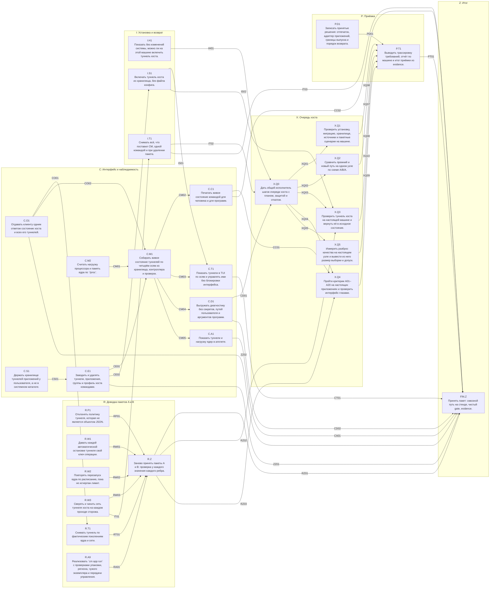

# Завершающий пакет: доводка A и B, интерфейс, установка и возврат, очередь хоста, приёмка — DAG

Дата: 2026-10-11. Источник: [tools/fin_dag.py](tools/fin_dag.py) (правится только он). Основания: [REVIEW-2026-10-11-AB.md](REVIEW-2026-10-11-AB.md), [AB-DAG.md](AB-DAG.md), [ADR-HOST-FLOW.md](ADR-HOST-FLOW.md), [ADR-DNS.md](ADR-DNS.md), [ADR-XRAY-DATAPATH.md](ADR-XRAY-DATAPATH.md), [ADR-BROWSER-IDENTITY.md](ADR-BROWSER-IDENTITY.md), [I17D-NAV.md](I17D-NAV.md), [INSTALL-PLAN.md](INSTALL-PLAN.md), [ITERATIONS.md](ITERATIONS.md) (критерии A01–A20), [QUESTIONS.md](QUESTIONS.md).

Схема:
- **направление** — группа вершин одной темы;
- **вершина** — одна задача (одно предложение);
- **ребро** u → v — контракт: что u гарантирует v, как это проверить и с какими значениями.

Роли:
- **роль 1** (Grok 4.7) пишет код вершин волнами — [GROK-FIN-CODE.md](GROK-FIN-CODE.md);
- **роль 2** (ChatGPT Luna 6) пишет тесты и проверки по рёбрам двумя проходами — [TESTS-FIN.md](TESTS-FIN.md).

Пакет закрывает всё, что осталось в общем плане после пакетов A и B: доводку самих A и B, этап 8 (интерфейс, установка), очередь проверок на настоящей машине (X, V.05) и приёмку (I18).
Данные — `tools/fin_fix.py`, `tools/fin_ui.py`, `tools/fin_accept.py`; этот документ — их объединение.

## Что показало ревью пакетов A и B (2026-10-11)

Подробно — [REVIEW-2026-10-11-AB.md](REVIEW-2026-10-11-AB.md). Пакеты не приняты.

| Что | Состояние |
|---|---|
| Код: 29 из 30 вершин | типы и функции на месте, существующие тесты зелёные |
| `I11.A9` (`cm app run`) | не реализована: упаковка, регион, чужой экземпляр, сессия, передача управления к команде не подключены |
| Сторож | повторная автоматическая остановка не срабатывает; после неудачного перезапуска ядра повторов нет; сеть туннеля хоста не сверяется |
| `cm tunnel down` | после повторного `up` сеть не снимается (поколения ядра и сети расходятся) |
| `cm uninstall` | при включённом туннеле хоста оставляет правила: машина без сети до перезагрузки |
| Хранилище | нет команд, создающих туннель, приложение, группу; путь хранилища — системный каталог root, от пользователя не открывается. `cm tunnel up ID` на настоящей машине выполнить нельзя |
| Тесты | у всех 55 рёбер есть тест по имени, но из 326 значений большинство не проверяется: константы, `or True`, `>= 0`, несколько допустимых исходов |
| Gate | EXIT 101: гонка в стенде (ожидание без паузы); 4 теста отключены, из них 2 — ошибка фикстуры |

Отсюда первое направление плана (R) и новые правила роли 2: проверка у каждого значения, запрет пустых проверок, программа `tools/test_lint.py`.

## Решения координатора

Вопросы, из-за которых исполнители могли бы остановиться, решены здесь. Пользователь может отменить любое; до отмены исполнители действуют по таблице.

| № | Вопрос | Решение | Основание |
|---|---|---|---|
| D-F1 | Q26: что считать массовым отпечатком | Стратегии `local` и `crowd` из [ADR-BROWSER-IDENTITY](ADR-BROWSER-IDENTITY.md). UA и устройство не подменяются. Каталог устройств не создаётся | Лаборатория I15-R: подмена движка увеличивает уникальность |
| D-F2 | Q27: когда меняется личность | Только по команде пользователя. Таймера нет, 28 дней не используются. История — 5 записей (уже в коде) | То же; требование «не менять часто» выполняется по построению |
| D-X1 | Xray как ядро туннеля приложения | В выпуск не входит; Xray остаётся прокси-ядром. `I05.T02.b`, `I05.T05.a`, `I10.T02.b` — «не входит» | [ADR-XRAY-DATAPATH](ADR-XRAY-DATAPATH.md): без привилегий не открывает TUN |
| D-P1 | Flatpak, Snap | Отказ `unsupported_not_verified`. AppImage — частично | На машине нет ни одного такого приложения для проверки |
| D-H1 | Замена прежнего VPN хоста | В выпуске оба пути; по умолчанию прежний. Новый включает пользователь (`cm host set`). Смена умолчания — после PASS шага `hq-host`, отдельным решением | Новый путь на настоящей машине ещё не проверен |
| D-H2 | systemd-resolved | Туннель хоста — отказ `unsupported` | Перенаправление DNS для него не проверено |
| D-S1 | Оси STATE и APP в интерфейсе | Значение `verified` не выставляется; максимум — `partial` | Связь процесса с сессией и обход через шину сессии на настоящих приложениях не проверены |
| D-U1 | Остановка туннеля в TUI | С вопросом, который называет последствие; запуск — одной клавишей | Рекомендация [I17D-NAV](I17D-NAV.md) |
| D-Q1 | Автоматический выбор узла | В выпуск не входит: расчёт есть, к контроллеру не подключён. Пилот `hq-pilot` необязателен | Пороги не измерены на настоящих узлах |
| D-C1 | CI | Файл `.github/workflows/check.yml` есть; заработает после push — действие пользователя | Решение D9 |
| D-V1 | `V.02`, `I08.T01.a` | Выполнены раньше (`cm source …` и `tests/audit_v02_source.rs`; решение Q09); отмечаются закрытыми при приёмке | Код и коммит `4d5d994` |
| D-S2 | Где лежит хранилище туннелей приложений | У пользователя: `~/.local/share/cm/profiles`. Системное `/var/lib/cm/profiles` остаётся прежнему VPN хоста | Команды туннелей, TUI и апплет работают от пользователя; системный каталог ему закрыт (0700 root) |
| D-T1 | Имена сущностей | Идентификатор приложения или группы — до 30 знаков; туннель `t-<ID>`, профиль `p-<ID>`, данные `d-<ID>`, пресет `e-<ID>` | Реестр идентификаторов не допускает одного имени у двух сущностей; имя экземпляра контроллера — до 32 знаков |

За пользователем остаются только действия на его машине и вне её: запуск шагов очереди хоста, коммит и push, решение о выпуске.

## Кто что делает

| Кто | Что | Когда |
|---|---|---|
| Роль 1, Grok 4.7 | код всех вершин, кроме `R.Z` и `FIN.Z`; исправление дефектов | семь волн, gate после каждой |
| Роль 2, ChatGPT Luna 6 | проверки всех рёбер AB и FIN, стенды, evidence | первый проход — после волн 1–3; второй — после волн 4–7 |
| Координатор | ревью, споры по спецификации, остаток после двух кругов правок, отметка закрытых подзадач в общем плане | после каждого прохода роли 2 |
| Пользователь | запуск шагов очереди хоста, коммит и push, решение о выпуске | когда удобно; на ход ролей не влияет |

## Направления

| | Направление | Цель | Вершины |
|---|---|---|---|
| R | Доводка пакетов A и B | Закрыть дефекты ревью и заново принять все 55 рёбер AB с проверкой каждого значения. | R.P1, R.W1, R.W2, R.W3, R.T1, R.A9, R.Z |
| C | Интерфейс и наблюдаемость | Пользователь заводит туннели и приложения командами, видит их настоящее состояние по осям и управляет ими из TUI и апплета. | C.O1, C.S1, C.E1, C.M2, C.M1, C.C1, C.T1, C.D1, C.A1 |
| I | Установка и возврат | Проверка готовности машины, туннель хоста из хранилища, гарантированное снятие всего, что поставил CM. | I.H1, I.S1, I.T1 |
| X | Очередь хоста | Проверки на настоящей машине — одной командой каждая, с планом, защитой от потери сети и откатом. | X.Q0, X.Q1, X.Q2, X.Q3, X.Q4, X.Q5 |
| P | Приёмка | Решения по открытым вопросам записаны; итог «готово или нет» выводится из evidence программой, а не оценкой. | P.D1, P.T1 |
| Z | Итог | Сквозной путь пользователя на стенде и evidence пакета. | FIN.Z |

## Граф

Стрелка — ребро с контрактом, подпись — id ребра.

## Вершины

| Вершина | Задача | Размер | Уровень | Зависит от | Файлы |
|---|---|---|---|---|---|
| `R.P1` | Отклонять политику туннеля, которая не является объектом JSON. | S | L1 | — | `src/net/policy.rs` |
| `R.W1` | Давать каждой автоматической остановке туннеля свой ключ операции. | S | L1 | — | `src/controller/watch.rs` |
| `R.W2` | Повторять перезапуск ядра по расписанию, пока не исчерпан лимит. | M | L1 | — | `src/controller/watch.rs`, `src/controller/core_ops.rs` |
| `R.W3` | Сверять и чинить сеть туннеля хоста на каждом проходе сторожа. | M | L1 | — | `src/net/host_audit.rs`, `src/net/mod.rs`, `src/controller/watch.rs`, `src/controller/boot.rs` |
| `C.O1` | Отдавать клиенту одним ответом состояние хоста и всех его туннелей. | M | L1 | — | `src/controller/protocol.rs`, `src/controller/dispatch.rs`, `src/controller/core_ops.rs`, `src/controller/watch.rs` |
| `R.T1` | Снимать туннель по фактическим поколениям ядра и сети. | M | L2 | C.O1 | `src/app/tunnel.rs` |
| `R.A9` | Реализовать `cm app run` с проверками упаковки, региона, чужого экземпляра и передачи управления. | L | L2 | — | `src/app/cli.rs`, `src/i18n_table.rs` |
| `R.Z` | Заново принять пакеты A и B: проверка у каждого значения каждого ребра. | L | L2 | R.P1, R.W1, R.W2, R.W3, R.T1, R.A9 | `tests/audit_ab_*.rs`, `tests/ab_stand.py`, `tests/fixtures/ab/blocked.json`, `docs/design/cm-network-manager/fin-evidence/<дата>/ab.json` |
| `I.H1` | Показать без изменений системы, можно ли на этой машине включить туннель хоста. | S | L1 | — | `src/net/cli.rs`, `src/net/host.rs`, `src/i18n_table.rs` |
| `C.S1` | Держать хранилище туннелей приложений у пользователя, а не в системном каталоге. | S | L1 | — | `src/sources/cli.rs`, `src/i18n_table.rs` |
| `C.E1` | Заводить и удалять туннели, приложения, группы и профиль хоста командами. | L | L1 | C.S1 | `src/profiles/edit.rs`, `src/profiles/mod.rs`, `src/app/define.rs`, `src/app/mod.rs`, `src/app/cli.rs`, `src/app/tunnel.rs`, `src/net/cli.rs`, `src/main.rs`, `src/i18n_table.rs` |
| `I.S1` | Включать туннель хоста из хранилища, без файла конфига. | S | L2 | C.E1 | `src/net/cli.rs`, `src/app/assign.rs`, `src/i18n_table.rs` |
| `I.T1` | Снимать всё, что поставил CM, одной командой и при удалении пакета. | M | L2 | R.W3 | `src/controller/teardown.rs`, `src/controller/mod.rs`, `src/controller/protocol.rs`, `src/controller/dispatch.rs`, `src/controller/server.rs`, `src/main.rs` |
| `C.M2` | Считать нагрузку процессора и память ядра по `/proc`. | S | L1 | — | `src/status/resources.rs`, `src/status.rs` |
| `C.M1` | Собирать живое состояние туннелей по четырём осям из хранилища, контроллера и проверок. | L | L1 | C.O1, C.M2, C.E1 | `src/status/live.rs`, `src/status.rs`, `src/status/tunnels.rs`, `src/env/record.rs`, `src/env/mod.rs`, `src/app/tunnel.rs`, `docs/design/cm-network-manager/I17-UI-CONTRACT.md` |
| `C.C1` | Печатать живое состояние командой для человека и для программ. | S | L2 | C.M1 | `src/app/tunnel.rs`, `src/i18n_table.rs` |
| `C.T1` | Показать туннели в TUI по осям и управлять ими без блокировки интерфейса. | L | L2 | C.M1, I.S1 | `src/status/page.rs`, `src/status.rs`, `src/tui.rs`, `src/tui/tunnels.rs`, `src/i18n_table.rs` |
| `C.D1` | Выгружать диагностику без секретов, путей пользователя и аргументов программ. | M | L1 | C.M1 | `src/diag/mod.rs`, `src/diag/export.rs`, `src/diag/redact.rs`, `src/lib.rs`, `src/main.rs`, `src/i18n_table.rs` |
| `C.A1` | Показать туннели и нагрузку ядер в апплете. | M | L3 | C.M1 | `src/status/panel.rs`, `src/status.rs`, `cosmic/src/tunnels.rs`, `cosmic/src/main.rs`, `cosmic/src/applet.rs`, `cosmic/src/panel.rs`, `cosmic/src/jobs.rs`, `cosmic/src/model.rs` |
| `X.Q0` | Дать общий исполнитель шагов очереди хоста с планом, защитой и откатом. | M | L2 | I.H1, I.T1, C.D1 | `tests/hostq/run.py`, `tests/hostq/lib.py`, `tests/hostq/steps/__init__.py` |
| `X.Q1` | Проверить установку, миграцию, хранилище, источники и пакетные сценарии на машине. | M | L4 | X.Q0 | `tests/hostq/steps/install.py`, `tests/hostq/steps/migrate.py`, `tests/hostq/steps/store.py`, `tests/hostq/steps/source.py`, `tests/hostq/steps/packages.py` |
| `X.Q2` | Сравнить прежний и новый путь на одном узле по схеме A/B/A. | M | L4 | X.Q0 | `tests/hostq/steps/parity.py` |
| `X.Q3` | Проверить туннель хоста на настоящей машине и вернуть её в исходное состояние. | L | L4 | X.Q0, R.Z, I.S1 | `tests/hostq/steps/host.py` |
| `X.Q4` | Пройти критерии A01–A20 на настоящих приложениях и проверить интерфейс глазами. | L | L4 | X.Q0, R.Z, C.C1 | `tests/hostq/steps/apps.py` |
| `X.Q5` | Измерить разброс качества на настоящем узле и вывести из него размер выборки и допуск. | M | L4 | X.Q0 | `tests/hostq/steps/pilot.py` |
| `P.D1` | Записать принятые решения: отпечаток, адаптер приложений, границы выпуска и порядок возврата. | M | D | — | `docs/design/cm-network-manager/ADR-FINGERPRINT.md`, `docs/design/cm-network-manager/I15R-CATALOG.md`, `docs/design/cm-network-manager/ADR-APP-ADAPTER.md`, `docs/design/cm-network-manager/RELEASE-SCOPE.md`, `docs/design/cm-network-manager/QUESTIONS.md` |
| `P.T1` | Выводить трассировку требований, отчёт по машине и итог приёмки из evidence. | M | L0 | P.D1, X.Q1, X.Q2, X.Q3, X.Q4, X.Q5 | `docs/design/cm-network-manager/tools/accept.py`, `docs/design/cm-network-manager/I18-TRACE.md`, `docs/design/cm-network-manager/X-RUNTIME-REPORT.md`, `docs/design/cm-network-manager/I18-ACCEPTANCE.md` |
| `FIN.Z` | Принять пакет: сквозной путь на стенде, чистый gate, evidence. | L | L2 | R.Z, I.T1, C.C1, C.T1, C.D1, C.A1, P.T1 | `tests/fin_stand.py`, `tests/audit_fin_e2e.rs`, `docs/design/cm-network-manager/fin-evidence/<дата>/summary.json` |

## Рёбра: контракт, проверка, значения

### RP01 · R.P1 → R.Z (L1)

- **Контракт:** Политика читается только из объекта JSON ограниченного размера.
- **Как проверить:** `tests/audit_ab_policy.rs`.
- **Значения:**
  - `parse(b"[]")`, `parse(b"null")`, `parse(b"1")`, `parse(b"\"x\"")` → `Err(NetError::Unsupported)`
  - `parse(b"{}")` → политика по умолчанию: ipv6 Block, fake_ip Forbidden, lifetime Pinned, failure Block
  - объект длиной `MAX_POLICY_BYTES + 1` (допустимый JSON, дополненный пробелами) → `Err`
  - `{"lifetime":"refcount","extra":1}` → `Err`: неизвестное поле

### RW01 · R.W1 → R.Z (L1)

- **Контракт:** Автоматическая остановка срабатывает каждый раз, а не только первый.
- **Как проверить:** `tests/audit_ab_watch.rs`: подменные ядро, `NetExec`, `NetQuery`; время задаёт тест; держатели — дерево-фикстура `/proc` и каталог `netns` в тестовом режиме.
- **Значения:**
  - политика refcount: запуск, держатели ушли, прошло 5000 мс → ядро остановлено, в записи исполнителя есть команды снятия сети, состояние stopped
  - тот же экземпляр поднят снова, держатели ушли, прошло 5000 мс → остановлен второй раз; в журнале владельца две завершённые операции с разными ключами вида `auto-stop-<число>-<число>`
  - `auto_txn("revert", i64::MAX, u32::MAX)` — длина 42, только `a-z0-9-`; `auto_txn("stop", -5, 1)` = `auto-stop-0-1`
  - подменное ядро отвечает ошибкой на остановку → команд снятия сети в записи нет, состояние blocked
  - политика pinned при тех же событиях → ни одной команды, состояние up

### RW02 · R.W2 → R.Z (L1)

- **Контракт:** Перезапуски ядра идут по расписанию до лимита, затем туннель объявляется отказавшим.
- **Как проверить:** `tests/audit_ab_watch.rs`: подменное ядро считает запуски; проходы — вызовы `tick` с заданным временем.
- **Значения:**
  - ядро не запускается, проходы каждые 2000 мс от 0 до 160000: попытки запуска ровно на проходах 2000, 4000, 10000, 40000, 160000 — всего 5
  - после прохода 160000: `tunnel_state` → state failed, restarts 5; на проходах 162000 и 164000 попыток нет
  - между проходами 0 и 160000 состояние blocked; команд `ip` и `nft` от шага «ядра» в записи исполнителя нет
  - ядро запускается с третьей попытки (проход 10000) → на проходе 12000 состояние up, restarts 3
  - `worker_start` после failed → состояние starting, restarts 0

### RW03 · R.W3 → R.Z (L1)

- **Контракт:** Каждое недостающее звено сети хоста находится и чинится своими командами, приёмник — раньше туннеля.
- **Как проверить:** `tests/audit_ab_host.rs` (чистые функции), `tests/audit_ab_watch.rs` (проход сторожа с подменным `NetQuery`).
- **Значения:**
  - полное состояние при одном внешнем интерфейсе с одним адресом → `host_audit` пуст
  - нет правила IPv4 2001 → `[MissingRule{v6:false, priority:2001}]`; починка — одна команда `ip rule add priority 2001 lookup 91`
  - нет правила IPv6 2001 → `[MissingRule{v6:true, priority:2001}]`; починка — `ip -6 rule add priority 2001 lookup 91`
  - нет `cmtunh` → `[MissingTun, MissingTunRoute]`; починка — четыре команды: tuntap add, addr add, link set mtu up, `ip route replace default dev cmtunh table 90`
  - нет `cmsink` и правила 2000 → в командах починки создание приёмника стоит раньше `ip rule add priority 2000 lookup 90`
  - `firewall_present = false` → `[MissingFirewall]`; починка — одна команда `nft -f -` с текстом `render_host_table`
  - проход сторожа при `MissingTun`: после починки ядру `host` назначен перезапуск на этот же момент времени
  - режим хоста `proxy` или `host.json` нет → запросов наблюдения хоста и команд нет
  - экземпляр `host` занят операцией клиента → шаг хоста пропущен: запросов наблюдения и команд нет, смена внешних интерфейсов тоже не выполняется

### CO01 · C.O1 → R.T1 (L1)

- **Контракт:** Обзор отдаёт клиенту поколения ядра и сети отдельно.
- **Как проверить:** `tests/audit_fin_overview.rs`.
- **Значения:**
  - после `net_apply` с поколением 1 и `worker_start` с поколением 2: строка экземпляра — worker_generation 2, net_generation 1
  - после `worker_stop`: worker_generation пусто, net_generation 1
  - после `net_revert`: каталог экземпляра остаётся, оба поколения пусты, netns пусто

### RT01 · R.T1 → R.Z (L2)

- **Контракт:** `cm tunnel down` всегда снимает то, что поднял `up`, и повторяется без ошибки.
- **Как проверить:** `tests/ab_stand.py`, раздел `tunnel`.
- **Значения:**
  - `up t1` → `down t1 --keep-net` → `up t1` → `down t1`: все четыре — код 0; после последней нет `cm-<i>` в `ip netns list`, нет правила `iif cmv<i>h`, нет ядра
  - `down t1` второй раз → код 0, в журнале контроллера новых операций нет
  - `down t1` при живом процессе в сети → `[in_use]`, код 5; с `--force` → код 0
  - `kill -9` ядра, затем `up t1` до восстановления → `[busy]`, код 3
  - `up` для экземпляра, у которого сеть создана другим клиентом того же владельца (`net_generation` задано) → код 0; для экземпляра без сети при ответе conflict → `[conflict]`, код 3

### RA01 · R.A9 → R.Z (L2)

- **Контракт:** `cm app run` выполняет проверки по порядку и останавливается на первом отказе.
- **Как проверить:** `tests/audit_ab_cli.rs` (отказы до контроллера), `tests/ab_stand.py`, разделы `apps` и `private`.
- **Значения:**
  - `cm app run t1 -- /usr/bin/systemd-run --user x` без контроллера → `[unsupported_executor_outside]`, код 2 (не 4)
  - описание с Flatpak → `[unsupported_not_verified]`, код 2
  - пояс региона отсутствует в `/usr/share/zoneinfo` → `[zone_missing]`, код 2; локаль не установлена → `[locale_not_installed]`, код 2, с `--allow-missing-locale` запуск идёт
  - программа уже работает вне сети туннеля → `[running_elsewhere]`, код 5; с `--allow-running` → код 0
  - программа-фикстура `tests/brokers/single_instance.py`, завершившаяся сразу, без новых процессов в сети → `[handed_off]`, код 6
  - обычный запуск → в stdout pid, код 0; через 1 с процесс с этим pid в сети туннеля (`readlink /proc/<pid>/ns/net` совпадает с netns туннеля)
  - `--data isolated --ipc private` → файл `config/session-s<12 шестнадцатеричных>.json` с правами 0600; у процесса `XDG_RUNTIME_DIR` — каталог сессии, `DBUS_SESSION_BUS_ADDRESS` не задан

### RZ01 · R.Z → FIN.Z (L2)

- **Контракт:** У каждого значения каждого ребра AB есть проверка, и ни одна проверка не пройдёт на сломанном коде по построению.
- **Как проверить:** `tools/test_lint.py --dags AB`; `tests/check_audit.sh`.
- **Значения:**
  - `python3 docs/design/cm-network-manager/tools/test_lint.py --dags AB` → EXIT 0; «без проверки 0», «замечаний 0»
  - в `tests/audit_ab_*.rs` нет `#[ignore]`: D01, U02 сняты после `R.P1` и `R.A9`; F01 и F02 — ошибка фикстуры (каталог `leases` не создан до `LeaseRegistry::create`), исправляется в тесте
  - в `tests/ab_stand.py` нет циклов ожидания без `sleep`: функция `app()` опрашивает файл каждые 100 мс до срока
  - стенд — 5 прогонов подряд, каждый EXIT 0; gate — 3 прогона подряд, каждый EXIT 0 без строк SKIPPED
  - `tests/fixtures/ab/blocked.json` — не больше 12 значений, все уровня L2, у каждого названы причина и шаг очереди хоста

### RZ02 · R.Z → X.Q3 (L2)

- **Контракт:** Шаг очереди хоста повторяет на машине то, что уже прошло на стенде, а не проверяет впервые.
- **Как проверить:** `tests/ab_stand.py`, раздел `host`; сверка списков в `tests/audit_fin_hostq.rs`.
- **Значения:**
  - каждый `stand_ref` проверок шага `hq-host` — номер значения ребра уровня L2 из `AB-DAG.json` или `FIN-DAG.json` (вид `IT03.3`), и проверка с этой меткой есть в `tests/ab_stand.py` или `tests/fin_stand.py`
  - проверок шага `hq-host` без `stand_ref` не больше трёх, и у каждой указана причина (`needs_real_uplink`, `needs_real_dns`, `needs_suspend`)

### RZ03 · R.Z → X.Q4 (L2)

- **Контракт:** Каждый критерий A01–A20 привязан либо к проверке стенда, либо к проверке шага на машине.
- **Как проверить:** `tests/audit_fin_hostq.rs`: таблица `ACCEPTANCE` шага `hq-apps`.
- **Значения:**
  - в таблице 20 строк A01–A20; у каждой — `stand` (метки рёбер) или `host` (имена проверок шага), либо оба
  - строк только со `stand` не больше восьми; A01, A02, A06, A07, A11, A12, A16, A20 имеют `host`
  - каждое ребро из `stand` есть в `AB-DAG.json` или `FIN-DAG.json` и имеет хотя бы одну проверку с меткой в `tests/ab_stand.py` или `tests/fin_stand.py`

### IH01 · I.H1 → X.Q0 (L1)

- **Контракт:** Проверка готовности хоста — чистая функция от наблюдений с фиксированным порядком строк.
- **Как проверить:** `tests/audit_fin_install.rs`.
- **Значения:**
  - чистая машина (nft есть, один внешний интерфейс, сокет есть, режим off) → 10 строк, все `ok`, код 0
  - интерфейс `cm-vpn` → строка 2: `check=legacy_vpn result=block [legacy_vpn_active]`, код 1
  - правило с таблицей 2022 → строка 3 block `[foreign_autoroute]`; resolved → строка 4 block `[resolved_unsupported]`
  - firewalld и NetworkManager → строки 5 и 6 `warn`, код 0
  - нет маршрута по умолчанию → строка 7 block `[no_uplink]`; 9 внешних интерфейсов → block `[too_many_uplinks]`
  - режим off и существует `cmsink` → строка 9 block `[stale_host_net]`
  - строка 10: `check=rp_filter result=ok all=0 default=2` при таких значениях в фактах
  - команда не обращается к сокету контроллера и не выполняет `ip … add|del|set|replace`, `nft -f` (запись подменного исполнителя пуста)

### IS01 · I.S1 → C.T1 (L1)

- **Контракт:** Профиль туннеля хоста разрешается из хранилища до обращения к контроллеру.
- **Как проверить:** `tests/audit_ab_assign.rs`, `tests/audit_fin_install.rs`.
- **Значения:**
  - снимок с политикой хоста, профилем и источником → `assign::host` возвращает источник и выбор узла этого профиля
  - политики хоста нет → `Err(UnknownProfile)`; профиль ссылается на отсутствующий источник → `Err(UnknownSource)`
  - `cm host set tunnel` без источника конфига, с обоими источниками, `cm host set proxy --stored` → код 2, обращений к контроллеру нет

### IS02 · I.S1 → X.Q3 (L2)

- **Контракт:** `cm host set tunnel --stored` поднимает туннель хоста на узле из хранилища.
- **Как проверить:** `tests/fin_stand.py`, раздел `host`: хранилище с источником, узлы — подставные прокси.
- **Значения:**
  - `cm host define --source s1`, затем `cm host set tunnel --stored` → код 0; `cm host status` → `mode=tunnel`; запрос хоста — HTTP 200, счётчик соединений подставного узла вырос
  - в файле поколения экземпляра `host` нет ключа `dns`; права файла 0600
  - без `cm host define` → `[unknown_profile]`, код 2; режим остался off

### IT01 · R.W3 → I.T1 (L1)

- **Контракт:** Снятие удаляет ровно те объекты, которые сверяет сторож хоста.
- **Как проверить:** `tests/audit_fin_install.rs`: подменные `NetExec` и `NetQuery`.
- **Значения:**
  - `host.json` с одним внешним интерфейсом → команды: `host_firewall_commands(None)`, затем `host_destroy_commands`; файл удалён; запись `net:host` очищена
  - `host.json` нет, наблюдаются `cmsink` и правила 1990, 2000, 2001 → те же команды плюс по одной `ip rule del priority N` на каждое наблюдаемое правило схемы
  - чужое правило с приоритетом 1990 и таблицей 200 и правило с приоритетом 3000 → не удаляются
  - две аренды сетей приложений → для каждой команды снятия, аренда освобождена, каталог `etc_root/cm-<i>` удалён; отчёт `nets = 2`
  - повтор на чистом состоянии → отчёт `{cores:0, nets:0, host:false, errors:0}`

### IT02 · I.T1 → X.Q0 (L2)

- **Контракт:** Кадр снятия доступен только суперпользователю и не пересекается с проходом сторожа.
- **Как проверить:** `tests/audit_fin_install.rs` (кадр), `tests/fin_stand.py`, раздел `teardown`.
- **Значения:**
  - кадр `teardown` от uid 1000 → `denied`; состояние не изменилось
  - кадр от uid 0 → ответ `ReplyData::Teardown`; следующий `overview` → host mode off, список туннелей без поколений
  - `cm controller teardown --offline` вне тестового режима не от uid 0 → код 4; при `--base` вне тестового режима → код 2
  - после снятия проход сторожа не выполняет ни одной команды (запись исполнителя пуста два прохода подряд)

### IT03 · I.T1 → FIN.Z (L2)

- **Контракт:** После снятия на стенде не остаётся ни одного объекта CM, и сеть хоста работает напрямую.
- **Как проверить:** `tests/fin_stand.py`, раздел `teardown`.
- **Значения:**
  - до снятия: туннель хоста включён, два туннеля приложений двух владельцев работают
  - `cm controller teardown` → код 0, отчёт `cores=3 nets=2 host=true errors=0`
  - после: `ip rule` без приоритетов 1000–2001; `ip link` без `cmtunh`, `cmsink`, `cmv*`, `cmtun*`; `ip netns list` без `cm-*`; `nft list tables` без `cm_host`; таблица `inet cm` без правил для интерфейсов
  - запрос хоста — HTTP 200 напрямую; процессов ядра нет
  - повтор команды → код 0, отчёт из нулей

### CO02 · C.O1 → C.M1 (L1)

- **Контракт:** Обзор перечисляет только экземпляры владельца, с состоянием сторожа и без данных запроса.
- **Как проверить:** `tests/audit_fin_overview.rs`: контроллер с подменными исполнителями.
- **Значения:**
  - владелец с экземплярами `b`, `a` и `host` → `tunnels` из двух строк в порядке `a`, `b`; `host` в списке нет
  - экземпляры другого uid в ответ не попадают; чужой владелец туннеля хоста видит `host.mode = off`
  - каталог с именем, не проходящим `InstanceId::new`, пропускается; при 70 экземплярах в ответе 64 строки
  - экземпляр без запусков → state stopped, restarts 0, holders 0, оба поколения и netns пусты
  - класс операции — Status; подменный `Authorizer` с отказом → `denied`

### CS01 · C.S1 → C.E1 (L1)

- **Контракт:** Путь хранилища зависит только от uid и окружения, и пользователь не пишет в системное хранилище.
- **Как проверить:** `tests/audit_fin_define.rs`.
- **Значения:**
  - `store_root_for(1000, …)` при `HOME=/home/u` без других переменных → `/home/u/.local/share/cm/profiles`
  - при `XDG_DATA_HOME=/d` → `/d/cm/profiles`; при `CM_PROFILE_STORE=/x` → `/x` для любого uid
  - `store_root_for(0, …)` при `state_dir=/var/lib/cm` и заданном `HOME` → `/var/lib/cm/profiles`
  - `store_writes_allowed(1000, false)` → true; `(0, false)` → false; `(0, true)` → true
  - `cm app define` во временном `HOME` без `CM_PROFILE_STORE` создаёт `<HOME>/.local/share/cm/profiles` с правами 0700

### CE01 · C.E1 → C.M1 (L1)

- **Контракт:** Команды описания создают граф, который проходит проверку модели и разрешается назначением.
- **Как проверить:** `tests/audit_fin_define.rs`: чистые функции `profiles::edit` на снимках теста.
- **Значения:**
  - `define_app` с собственным туннелем на снимке с источником `s1` → в кандидате приложение `web`, туннель `t-web`, профиль `p-web`, профиль данных `d-web`, пресет `e-web`; `validate()` → Ok; `assign::application` → instance `t-web`, shared false
  - `define_group g1`, затем два `define_app` с `Group(g1)` → `assign::application` обоих даёт instance `t-g1`, shared true
  - без `--node` → выбор `Policy{name:"auto"}`; с узлом другого источника → `Err(UnknownNode)`
  - идентификатор длиной 31 → `Err(BadId)`; повтор `define_app web` → `Err(Exists)`; `define_app` после `remove_app` с тем же ID → `Err(Exists)`
  - `remove_group` при живом приложении группы → `Err(InUse)`; `remove_app` убирает `t-`, `p-`, `d-`, `e-` и оставляет источник
  - `--exec relative/path` → `Err(BadValue)`; пояс `../x` → `Err(BadValue)`; снимок не изменён
  - `define_host` дважды с разными источниками → одна политика `host-policy`, профиль `p-host` указывает на второй источник

### CE02 · C.E1 → I.S1 (L2)

- **Контракт:** Команды пишут хранилище одной записью и не трогают работающий туннель.
- **Как проверить:** `tests/audit_fin_define.rs` (команды во временном хранилище), `tests/fin_stand.py`, раздел `define`.
- **Значения:**
  - `cm app define web --exec /usr/bin/true --source s1` → `ok web`, код 0; ревизия хранилища выросла ровно на 1
  - `cm app list` → строка `id=web tunnel=t-web shared=no exec=/usr/bin/true`
  - неизвестный источник → `[unknown_source]`, код 2; ревизия не изменилась
  - стенд: `cm tunnel up t-web`, затем `cm app remove web` → `[in_use]`, код 5; после `cm tunnel down t-web` → `ok web`
  - в выводе команд нет адресов узлов и URL источника

### CM01 · C.M2 → C.M1 (L1)

- **Контракт:** Нагрузка считается по двум выборкам и не падает на необычных строках `/proc`.
- **Как проверить:** `tests/audit_fin_live.rs`.
- **Значения:**
  - строка stat с именем процесса `(a b) c)` → поля берутся после последней `)`; utime 150, stime 50 → 200
  - выборки (ticks 100, 0 мс) и (ticks 300, 2000 мс) при 100 тиках в секунду → cpu_pct 100
  - Δмс = 0 или ticks уменьшились → cpu_pct 0
  - statm `1000 2560 …` при странице 4 КБ → rss_kb 10240; `usage_text` → `cpu 0% · 10 МБ`
  - нет каталога процесса → `sample` возвращает None

### CM02 · C.M1 → C.C1 (L1)

- **Контракт:** Каждая ось получает значение только из своего источника; без источника — unknown.
- **Как проверить:** `tests/audit_fin_live.rs`: чистая функция `live::build`.
- **Значения:**
  - state up, записи региона нет, держателей нет → net verified, region unknown, state unknown, app unknown; actions [Down, Verify, Run]
  - запись региона Agreed DE с expected DE и поколением, равным поколению ядра → region verified, country DE; возраст = (now − at)/1000
  - та же запись с другим поколением → region unknown, country пусто
  - expected US при Agreed DE → region blocked, failure region-mismatch, condition blocked
  - state failed → net error, failure core-failed, actions [Up]; state blocked → failure core-restarting, actions [Down]
  - 2 держателя и запись сессии → state partial, app partial, sessions 2; ни в одном наборе входов `state` и `app` не равны verified
  - контроллер Unavailable → все оси unknown, возраста нет, actions пуст, строки туннелей хранилища присутствуют
  - экземпляр из обзора без туннеля в хранилище → строка с id "" после строк хранилища

### CM03 · C.M1 → C.T1 (L1)

- **Контракт:** Клавиши страницы дают только разрешённые действия; остановка и режим хоста — через вопрос.
- **Как проверить:** `tests/audit_fin_page.rs`: `status::page::Page` на собранных `LiveView`.
- **Значения:**
  - строка stopped: `u` → `Run(["tunnel","up","t-web"])`; `x` → `Message`, вопрос не открыт
  - строка up: `x` → открыт `Confirm::Down`; `Tab` → вопрос остаётся; `n` → `Message`, вопрос закрыт; `x`, `y` → `Run(["tunnel","down","t-web"])`
  - строка up со страной DE: `v` → `Run(["tunnel","verify","t-web","--country","DE"])`
  - хост off без профиля: `h` → `Message`; с профилем и `legacy_vpn` → `Message`, вопрос не открыт; с профилем без него → `HostOn`, `Enter` → `Run(["host","set","tunnel","--stored"])`
  - хост tunnel: `h`, `y` → `Run(["host","set","off"])`
  - `replace` с новым порядком строк сохраняет выбор по instance; `↓` на последней строке выбор не меняет
  - `q`, `Esc`, `Backspace` вне вопроса → `Back`; `Esc` в вопросе → отмена, не `Back`

### CM04 · C.M1 → C.D1 (L1)

- **Контракт:** Очистка убирает каждый класс секретов, а выгрузка с остатком не пишется.
- **Как проверить:** `tests/audit_fin_diag.rs`.
- **Значения:**
  - `scrub` строки с `/home/alice/x`, `alice`, `vless://id@host:443?x=1`, `password=abc`, uuid, 40-символьным токеном, `8.8.4.4` при home `/home/alice` и user `alice` → `find_secrets` результата пуст; исходных значений в результате нет
  - адреса `10.213.0.1`, `198.18.64.2`, `192.168.1.1`, `fe80::1` остаются как есть
  - `find_secrets` на исходной строке возвращает `url`, `key_value`, `uuid`, `long_token`, `public_ip`
  - `shape` документа с 3 узлами (2 vless, 1 trojan), 1 группой, 5 правилами → `{proxies:3, groups:1, rules:5, protocols:{trojan:1, vless:2}}`
  - свойство, 10 000 случаев: для случайной строки из алфавита секретов `find_secrets(scrub(s))` пуст

### CM05 · C.M1 → C.A1 (L1)

- **Контракт:** Строки апплета повторяют оси живой модели и не складывают туннели в один статус.
- **Как проверить:** `tests/audit_fin_page.rs`: `status::panel`.
- **Значения:**
  - два туннеля up и один failed → headline «туннели: 2 работают, 1 с ошибкой»
  - контроллер Unavailable → headline «контроллер недоступен»; пустой список → «туннелей нет»
  - строка туннеля: axes — четыре символа через пробел в порядке net, region, state, app; problem true при failed и при оси region blocked
  - первая строка — хост; при режиме off её axes содержит «выкл»

### CC01 · C.C1 → X.Q4 (L2)

- **Контракт:** Вывод `cm tunnel list` разбирается построчно и одинаков по содержанию с JSON.
- **Как проверить:** `tests/fin_stand.py`, раздел `list`.
- **Значения:**
  - до запуска: строка `host mode=off state=stopped uplinks=- defined=no legacy_vpn=no core_pid=-`; строка туннеля оканчивается на `state=stopped net=unknown region=unknown data=unknown app=unknown holders=0 restarts=0 generation=- country=- core_pid=-`
  - после `cm tunnel up t-web`: `state=up net=verified`, `generation=1`, `core_pid` — pid живого процесса ядра
  - после `cm tunnel verify t-web --country ZZ` с источниками стенда, отвечающими DE → `region=blocked`
  - `--json` разбирается в объект с ключами `at_unix_ms`, `controller`, `host`, `tunnels`; число туннелей равно числу строк текста минус одна
  - контроллер остановлен → код 4, строки туннелей хранилища напечатаны с unknown

### CC02 · C.C1 → FIN.Z (L2)

- **Контракт:** Состояние в выводе меняется вслед за событиями стенда не позже одного прохода сторожа.
- **Как проверить:** `tests/fin_stand.py`, раздел `list`.
- **Значения:**
  - `kill -9` ядра → не позже чем через 3 с `state=blocked net=blocked`; не позже чем через 8 с снова `state=up`, `restarts=1`
  - процесс в сети туннеля запущен → не позже чем через 3 с `holders=1 app=partial`; завершён → `holders=0 app=unknown`
  - `cm host set tunnel --stored` → строка хоста `mode=tunnel state=up`

### CT01 · C.T1 → FIN.Z (L2)

- **Контракт:** Страница рисуется на узком и широком терминале, на двух языках, и нигде не объявляет общий «зелёный» статус.
- **Как проверить:** `tests/audit_fin_page.rs`: `ratatui::backend::TestBackend`, состояния из `tests/fixtures/i17/states.json` и из `live::build`.
- **Значения:**
  - размеры 60×20, 80×24, 120×40: отрисовка без паники; при 60 колонках оси — одним символом, при 120 — символ и слово
  - в тексте экрана есть четыре заголовка осей; нет слов «защищено», «безопасно», «анонимно», «ok» как итога строки
  - возраст 3601 с → в ячейке есть `⚠`; возраст 59 с → нет
  - языки ru и en: подписи значений осей разные, символы одинаковые; токены команд не переведены
  - открытый вопрос остановки содержит имя туннеля и слова о том, что VPN хоста не меняется
  - состояние `контроллер недоступен` — отдельная строка; строки туннелей при этом есть
  - `Poller` с функцией сбора, которая спит 3 с: 100 вызовов `latest` и 100 вызовов `Page::key` подряд завершаются быстрее 100 мс; первое значение приходит не позже чем через 4 с; после уничтожения `Poller` функция сбора больше не вызывается (счётчик вызовов не растёт 3 с)

### CD01 · C.D1 → X.Q0 (L2)

- **Контракт:** Выгрузка содержит состояние, достаточное для разбора, и ни одного значения из конфигов и запросов.
- **Как проверить:** `tests/fin_stand.py`, раздел `diag`: источник стенда с узлами, у которых известны пароль и uuid.
- **Значения:**
  - `cm diag export --out -` → код 0; JSON с ключами `version`, `live`, `instances`, `units`, `kernel`, `checks`
  - в выводе нет пароля, uuid и адреса узла стенда, нет пути домашнего каталога и имени пользователя
  - `instances[].shape.proxies` равно числу узлов источника; `generations` перечисляет файлы поколений
  - файл по умолчанию создан с правами 0600, путь напечатан
  - `kernel` содержит ключи для пяти запросов; при включённом туннеле хоста в `ip -j rule` есть приоритет 2000

### CD02 · C.D1 → FIN.Z (L1)

- **Контракт:** Выгрузка, в которой после очистки найден секрет, не записывается.
- **Как проверить:** `tests/audit_fin_diag.rs`.
- **Значения:**
  - экспорт, в чьё поле `notes` тест подставил строку с uuid в обход `scrub` → запись отклонена, результат `export_not_clean`, файла нет
  - `cm diag export --out /нет/каталога/x` → код 2
  - в структуре `Export` нет полей с аргументами и окружением процессов (сериализованный документ не содержит ключей `argv`, `args`, `env`, `cmdline`)

### CA01 · C.A1 → FIN.Z (L3)

- **Контракт:** Апплет собирается, не блокирует панель сбором и не содержит действий над туннелями.
- **Как проверить:** gate (сборка и тесты `cosmic/`); ручная проверка — шаг `hq-apps`, раздел `applet`.
- **Значения:**
  - `tests/check_audit.sh` собирает и тестирует `cosmic/` с `--locked --offline` (строка есть в файле); `cosmic/src/main.rs` содержит `mod tunnels`
  - в `cosmic/src/tunnels.rs` нет вызовов `cm host set`, `cm tunnel up|down`, `controller::client::call` с операциями, кроме `Overview` (проверка поиском по исходнику)
  - `live::gather` вызывается только из задания `Kind::Tunnels` (поиск по `cosmic/src`: одно место вызова)

### XQ01 · X.Q0 → X.Q1 (L2)

- **Контракт:** План ничего не меняет, а запуск невозможен без согласия и точки возврата.
- **Как проверить:** `tests/audit_fin_hostq.rs` запускает `tests/hostq/run.py` с `CM_HOSTQ_FAKE`.
- **Значения:**
  - `run.py plan hq-install` → код 0; журнал команд пуст; в выводе строки с `! ` перед `sudo`
  - `run.py run hq-install` без `--yes` → `[needs_yes]`, код 3; журнал пуст
  - `run.py run hq-install --yes` без записи о снимке → `[no_snapshot]`, код 3; с `--no-snapshot` без `--backup-dir` → код 2
  - `run.py run hq-host --yes` без PASS у `hq-install` → `[requires hq-install]`, код 3
  - `run.py list` → по строке на каждый шаг из `tests/hostq/steps/`; у шага без evidence статус `-`
  - запуск от uid 0 (подменённый `os.geteuid`) → код 2

### XQ02 · X.Q0 → X.Q2 (L2)

- **Контракт:** В evidence попадают только статусы и слова из набора шага.
- **Как проверить:** `tests/audit_fin_hostq.rs`.
- **Значения:**
  - проверка с `detail`, содержащим URL или заглавные буквы → в файле `detail_rejected`
  - файл evidence содержит ключи `step`, `rev`, `binary_sha256`, `started`, `finished`, `status`, `checks`, `rollback` и ни одной строки из подменных ответов команд
  - две фазы A с разным `reach` → проверка сравнения UNKNOWN, не FAIL и не PASS
  - фазы A равны, B отличается на стадии `tls` → FAIL, `detail` `stage=tls`

### XQ03 · X.Q0 → X.Q3 (L2)

- **Контракт:** Откат выполняется при любом исходе шага, а потеря сети после него — отдельная тревога.
- **Как проверить:** `tests/audit_fin_hostq.rs` (подменные ответы); `tests/fin_stand.py`, раздел `hostq`, с `CM_HOSTQ_STAND=1`.
- **Значения:**
  - `run` шага бросает исключение → `rollback` вызван, в evidence `rollback` заполнен, статус шага FAIL
  - подменные ответы: связь до шага есть, после отката нет → в журнале есть `cm controller teardown`; проверка `network_restored` FAIL с p0; в выводе блок «как вернуть сеть» с номером снимка
  - связи нет до шага → `[no_network]`, код 3; `run` не вызывался
  - стенд: `run.py run hq-host --yes` внутри пространства имён → статус PASS или UNKNOWN; проверки 3, 4, 7, 8, 9, 10, 14 — PASS; после шага `ip rule` без приоритетов 1900–2001
  - стенд: шаг прерван `SIGTERM` после включения туннеля → не позже чем через 20 с правил 1900–2001 нет

### XQ04 · X.Q0 → X.Q4 (L2)

- **Контракт:** Ручная проверка без ответа — UNKNOWN, и шаг убирает за собой всё, что создал.
- **Как проверить:** `tests/audit_fin_hostq.rs`; `tests/fin_stand.py`, раздел `hostq`.
- **Значения:**
  - `ask` при закрытом stdin → `skip`; все проверки разделов `account`, `applet`, `tui` — UNKNOWN
  - ответ `n` на вопрос → проверка FAIL
  - стенд: `run.py run hq-apps --yes --source s1` → проверки a04, a05, a06, a07, a11, a14, a16_native_runs, a20_export_clean, a20_no_verified_state_app — PASS
  - стенд: после шага в `cm app list` и `cm group list` нет идентификаторов `hq-*`; `cm tunnel list` без экземпляров `t-hq-*` с поколениями

### XQ05 · X.Q0 → X.Q5 (L1)

- **Контракт:** Статус шага выводится из проверок одним правилом, код выхода — из статуса.
- **Как проверить:** `tests/audit_fin_hostq.rs`.
- **Значения:**
  - проверки [PASS, UNKNOWN] → шаг UNKNOWN, код 0
  - проверки [PASS, FAIL, UNKNOWN] → шаг FAIL, код 1
  - проверки [SKIP, SKIP] → шаг SKIP; `preflight` с FAIL → `run` не вызывался, шаг SKIP, код 3
  - `run.py all --yes`: шаг с FAIL p0 → следующие шаги не запускались

### XQ06 · X.Q1 → P.T1 (L2)

- **Контракт:** Шаги установки и миграции проверяют состояние, а не только код возврата команд.
- **Как проверить:** `tests/audit_fin_hostq.rs` (подменные ответы).
- **Значения:**
  - `hq-install`: подменный `systemctl is-enabled cm-controller.socket` → `disabled` → проверка `controller_socket_enabled` FAIL
  - sha256 бинарника отличается от записанного → `binary_matches_manifest` FAIL
  - состояние службы VPN хоста до и после разное → `legacy_vpn_untouched` FAIL с p0
  - `hq-source` при пустом хранилище → все проверки UNKNOWN, `detail` `no_sources`
  - `hq-packages` без `--with-uninstall` → `uninstall_leaves_no_net` UNKNOWN; в журнале нет `cm uninstall`
  - план `hq-install`: `rollback` не содержит команд удаления

### XQ07 · X.Q2 → P.T1 (L2)

- **Контракт:** Сравнение путей называет первую отличающуюся стадию и не делает выводов сверх измеренного.
- **Как проверить:** `tests/audit_fin_hostq.rs` (подменные ответы).
- **Значения:**
  - FlClash не найден → `flclash_vs_cm` UNKNOWN, `detail` `flclash_absent`; остальные сравнения выполняются
  - нет активной подписки прежнего VPN → все три проверки UNKNOWN, `detail` `no_legacy_subscription`; команд, меняющих систему, в журнале нет
  - после шага в журнале есть возврат прежней подписки и режима; проверка `legacy_restored` PASS
  - в выводе и evidence нет слов «исправлен», «fixed»

### XQ08 · X.Q3 → P.T1 (L2)

- **Контракт:** Шаг туннеля хоста отличает утечку от недоступности и не объявляет успех по косвенным признакам.
- **Как проверить:** `tests/audit_fin_hostq.rs` (подменные ответы); настоящий прогон — `tests/fin_stand.py` (ребро `XQ03`).
- **Значения:**
  - подменный ответ: после `kill -9` ядра запрос вернул 204 → `core_kill_blocks` FAIL с p0
  - хеш выхода совпал с прямым → `exit_differs` UNKNOWN, не FAIL
  - `cm host check` с `Block` `resolved_unsupported` → шаг SKIP, `detail` содержит токен; команд, меняющих систему, нет
  - `Block` только `legacy_vpn_active` → шаг идёт; в журнале `cm vpn stop` раньше `cm host set tunnel`, в откате — запуск прежнего VPN
  - без `--with-link-flap` и `--manual-suspend` → `uplink_flap` и `suspend_resume` UNKNOWN с причинами `needs_real_uplink`, `needs_suspend`

### XQ09 · X.Q4 → P.T1 (L2)

- **Контракт:** Каждый критерий приёмки имеет проверку и статус; непроверенное не выдаётся за проверенное.
- **Как проверить:** `tests/audit_fin_hostq.rs`.
- **Значения:**
  - без `--browser` → `a12_running_elsewhere` UNKNOWN; без `--appimage` → `a16_appimage_partial` UNKNOWN
  - подменный ответ: запрос из сети приложения после `kill -9` ядра вернул 204 → `a07_no_direct_after_kill` FAIL с p0
  - подменный ответ: `cm tunnel list` с `app=verified` → `a20_no_verified_state_app` FAIL
  - `a16_flatpak_refused` — PASS, только если вывод содержит `[unsupported_not_verified]` и код равен 2
  - в evidence есть раздел матрицы исполнителя со строкой на каждую проверенную упаковку

### XQ10 · X.Q5 → P.T1 (L1)

- **Контракт:** Размер выборки и допуск выводятся из измеренного разброса по записанной формуле.
- **Как проверить:** `tests/audit_fin_hostq.rs`: функции расчёта шага на заданных сериях.
- **Значения:**
  - серии A с медианами 100, 110, 104 мс → `noise` = 0.10; `min_margin` = 0.20
  - серия B с медианой 150 мс при этих A → `b_differs` true; с медианой 115 мс → false
  - серии, чьи медианы первых 10 проб расходятся на 0.30, а первых 20 — на 0.08 → `min_probes` = 20
  - расхождение серий A 0.6 → `noise_measured` UNKNOWN, `detail` `unstable`
  - шаг не пишет ни в один файл под `src/`

### PD01 · P.D1 → P.T1 (L0)

- **Контракт:** Каждое решение записано со статусом, а каждая подзадача вне выпуска названа поимённо.
- **Как проверить:** `tests/audit_fin_docs.rs`: разбор текста документов.
- **Значения:**
  - `ADR-FINGERPRINT.md`: таблица не короче 10 строк; в каждой строке статус из набора go, conditional, no-go; строка UA — no-go
  - `RELEASE-SCOPE.md`: пять разделов в заданном порядке; в разделе «Не входит» есть `I05.T02.b`, `I05.T05.a`, `I10.T02.b`; есть обе метки `accept:unknown`
  - раздел «Как вернуть» содержит `cm host set off`, `cm controller teardown`, `--offline` и слово «снимок»
  - `QUESTIONS.md`: разделы Q26 и Q27 начинаются словами «Решено координатором 2026-10-11»; число строк файла изменилось не больше чем на 4
  - ни в одном из четырёх новых документов нет слов «анонимно», «гарантирует анонимность»

### PT01 · P.T1 → FIN.Z (L0)

- **Контракт:** Итог приёмки — функция от evidence: одно невыполненное условие даёт «blocked» и называет, кто действует дальше.
- **Как проверить:** `tests/audit_fin_docs.rs` запускает `accept.py` на наборах входов из `tests/fixtures/fin/accept/`.
- **Значения:**
  - набор «всё выполнено» → `--check` код 0, `ready`
  - тот же набор без evidence шага `hq-host` → `blocked`; один `Blocker` с `who` user и командой `run.py run hq-host --yes`
  - шаг `hq-apps` со статусом UNKNOWN → `blocked` (обязательный шаг); шаг `hq-pilot` UNKNOWN → на итог не влияет, проверка попадает в список «Не проверено на машине»
  - дефект P1 в summary → `blocked`, `who` coder; замечание `test_lint` → `who` tester
  - подзадача без вершины и вне «Не входит» → `open`, `blocked`, `who` coordinator; `V.02` и `H.10` → `closed` (решения D-V1, D-C1)
  - подзадача `X.05` при шаге `hq-parity` со статусом UNKNOWN → `covered_unverified`; итог от неё не зависит
  - `X-RUNTIME-REPORT.md`: шаг UNKNOWN остаётся UNKNOWN; число строк равно числу шагов
  - `I18-TRACE.md`: 11 строк W01–W11; у W01 в подзадачах вне выпуска есть `I05.T05.a`
  - `--check` не создаёт и не меняет файлов (времена изменения прежние)

### ZZ01 · C.E1 → FIN.Z (L2)

- **Контракт:** Пользователь проходит весь путь командами продукта, без файлов, написанных руками, и без прямых кадров контроллеру.
- **Как проверить:** `tests/fin_stand.py`, раздел `journey`: хранилище с источником стенда, узлы — подставные прокси, источники страны — HTTP стенда.
- **Значения:**
  - `cm app define web --exec <программа-фикстура> --source s1 --zone Europe/Berlin --locale C.UTF-8` → `ok web`
  - `cm tunnel up t-web` → код 0; `cm tunnel list` → `state=up net=verified`
  - `cm app run web` → pid, код 0; процесс в сети туннеля; его запрос — HTTP 200 через подставной узел; счётчик прямых пакетов с адресов `10.213.0.0/16` на интерфейсе «интернета» равен 0
  - процесс видит пояс `Europe/Berlin` (`date +%Z` → `CET` или `CEST`), хост — свой
  - `cm tunnel verify t-web --country DE` при источниках, отвечающих DE → код 0; `cm tunnel list` → `region=verified country=DE`
  - `cm diag export --out -` → код 0, без адреса и пароля узла
  - `cm tunnel down t-web` при живом процессе → `[in_use]`, код 5; после завершения процесса → код 0
  - `cm app remove web` → `ok web`; `cm tunnel list` без строки `t-web`; на стенде нет `cm-*` в `ip netns list`

### ZZ02 · C.O1 → FIN.Z (L2)

- **Контракт:** Новые операции контроллера не ломают принятое раньше.
- **Как проверить:** `tests/check_audit.sh` целиком; `tests/audit_fin_e2e.rs`.
- **Значения:**
  - gate: EXIT 0, строк SKIPPED нет, три прогона подряд
  - число тестов в gate не меньше, чем до пакета, плюс тесты `audit_fin_*`
  - стенд `tests/fin_stand.py`: 5 прогонов подряд, каждый EXIT 0
  - `python3 docs/design/cm-network-manager/tools/test_lint.py --dags AB,FIN --strict` → EXIT 0

## Что закрывает пакет в общем плане

| Вершина | Закрывает подзадачи |
|---|---|
| `R.W1` | I12.T05.a |
| `R.W2` | I09.T03.a |
| `R.W3` | I07.T04.a, I09.T04.a |
| `R.T1` | I12.T02.a |
| `R.A9` | I11.T04.a, I13.T04.a, I14.T03.a |
| `R.Z` | I07.T05.a, I08.T05.a, I09.T05.a, I10.T05.a, I11.T05.a, I12.T05.a, I13.T02.a, I14.T04.a, I16.T05.a |
| `I.H1` | I07.T01.b |
| `I.S1` | I07.T02.a |
| `I.T1` | I09.T02.a |
| `C.O1` | I17.T01.a |
| `C.S1` | I12.T01.a |
| `C.E1` | I12.T01.a, I11.T01.a |
| `C.M2` | I17.T04.a |
| `C.M1` | I17.T01.a, I17.T02.a |
| `C.C1` | I17.T02.a |
| `C.T1` | I17.T02.a, I17.T05.a |
| `C.D1` | I17.T03.a |
| `C.A1` | I17.T04.a |
| `X.Q0` | X.07 |
| `X.Q1` | X.02, X.03, X.04, X.06 |
| `X.Q2` | X.05, X.08, V.05 |
| `X.Q3` | I07.T05.a, I09.T05.a, I10.T05.a |
| `X.Q4` | I13.T05.a, I15.T05.a, I17.T04.a, I17.T05.a, I18.T02.a, I18.T03.a |
| `X.Q5` | I16.T03.a |
| `P.D1` | I15-R.T04.a, I15-R.T05.a, I15.T01.a, I18.T04.a, I05.T02.b, I05.T05.a, I10.T02.b |
| `P.T1` | X.07, I18.T01.a, I18.T05.a |
| `FIN.Z` | I17.T05.a, I18.T03.a |

Подзадача закрывается, когда приняты все её вершины; подзадачи уровня L4 — когда пользователь прошёл соответствующий шаг очереди хоста.

Открытые подзадачи общего плана, которых нет ни в AB, ни в FIN:

| Подзадача | Что с ней |
|---|---|
| `H.10` | решение D-C1 |
| `V.02` | решение D-V1 |
| `I05.T02.a` | решение D-X1 |
| `I08.T01.a` | решение D-V1 |

